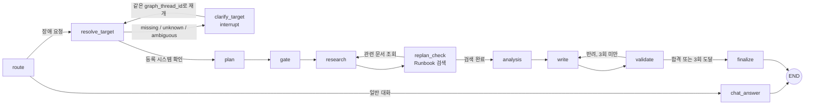
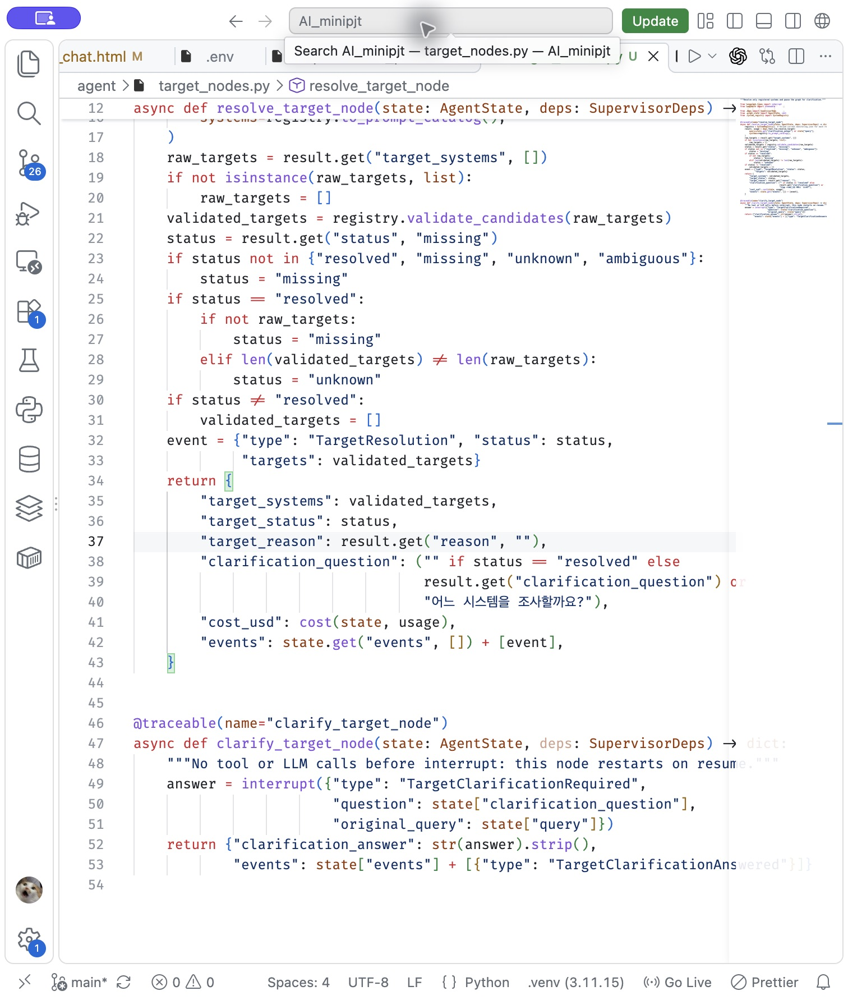
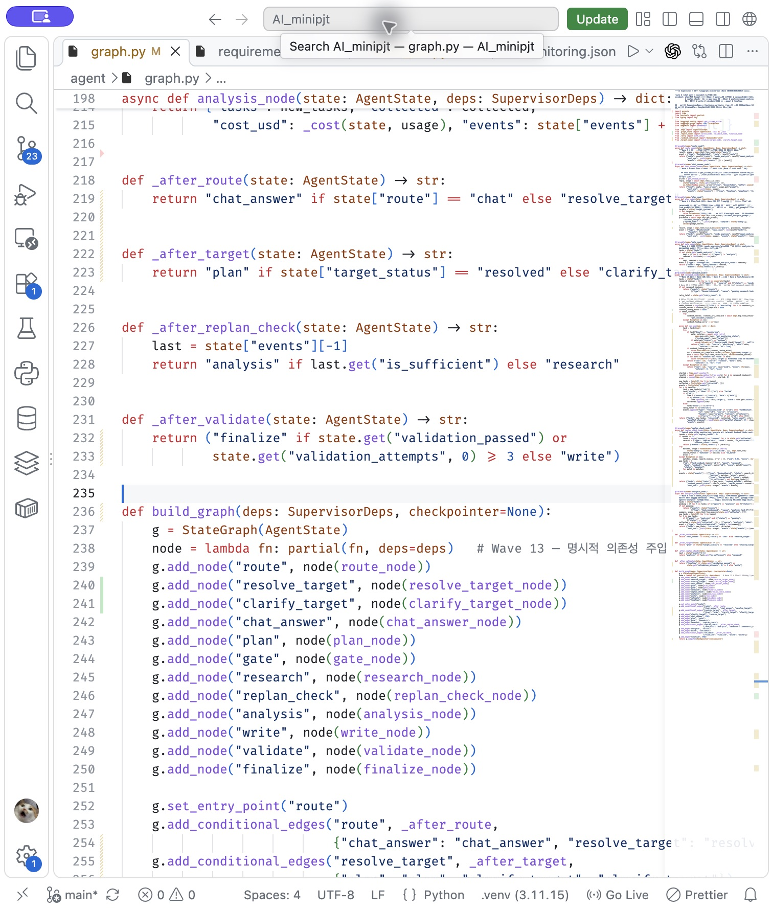
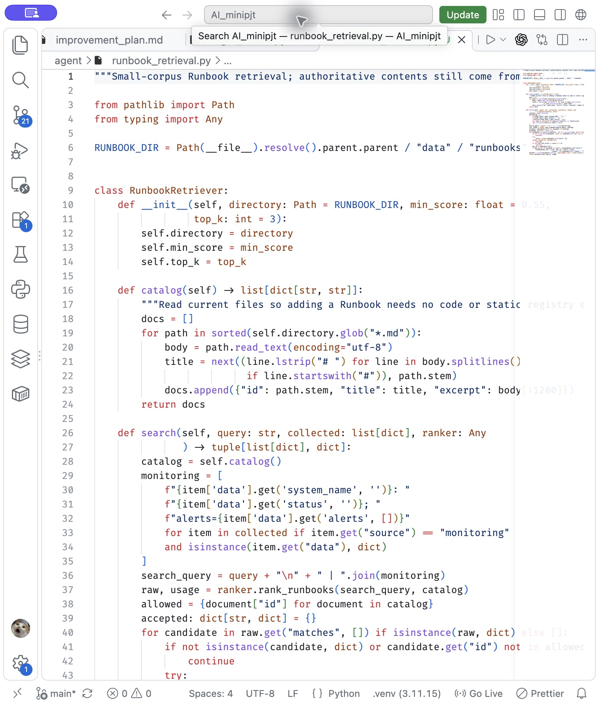
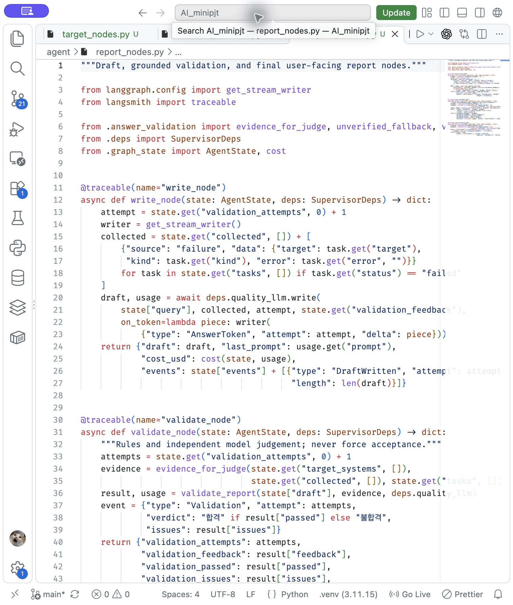
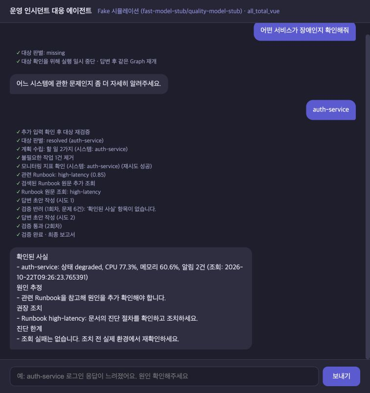
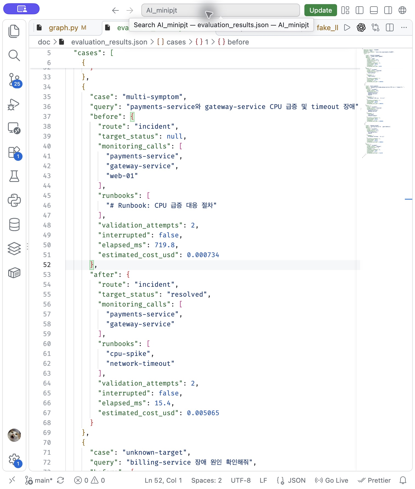

# AI 서비스 Mini-Project — 운영 장애 대응 에이전트 개선

> 선택 과제: **과제 1 — 기존 실습 코드의 기능 개선**
> 실행·측정 기준: 2026-10-22, Python 3.11, Fake 백엔드 및 고정 MCP 데이터


## 1. 선택 과제와 문제

기존 실습의 FastAPI + LangGraph + MCP 장애 대응 에이전트를 확장했습니다.<br>
수정 전에는 `auth-service` 기본값 또는 미등록 시스템 조회가 일어날 수 있었고,<br>
영문 키워드의 첫 번째 일치 항목으로 Runbook 하나만 고르며,<br>
`30자 이상`·`1)` 형식만 맞으면 보고서를 통과시켰습니다.<br>
세 번 실패하면 내용과 무관하게 강제 합격하는 경로도 있었습니다.

이번 과제 범위는 다음 Task에 집중했습니다.

| 개선 Task | 구현 내용 | 확인할 결과 |
| --- | --- | --- |
| 조사 대상 확인 | `monitoring.json`을 Registry로 읽고 LLM 후보를 코드로 검증. 불명확하면 `interrupt()`로 재질문 | 미등록 시스템은 Monitoring 호출 0건; 재개 후 원래 질문 유지 |
| 다중 Runbook 검색 | 질문+모니터링 알림으로 관련 문서를 선택하고 MCP Resource로 원문 조회. OpenAI 실행에는 임베딩 유사도 검색을 추가하고 기존 LLM 랭킹도 비교용으로 유지 | 기존 Fake 복합 장애 테스트에서 2개 Runbook; 임베딩 경로는 별도 단위 테스트 |
| 근거 검증 | 사실/추정/조치/한계 구분, 숫자·시스템·Runbook 출처를 코드와 Judge로 검증 | 반려 후 재작성; 3회 실패해도 강제 합격 없음 |
| 안전성·관찰성 | 일부 조회 실패 결과 유지, SSE에 검색·검증 상태 표시, 단위 테스트와 개선 전후 평가 | 실패 고지 및 재현 가능한 비교 |
| 모듈화 | 대상 노드, 보고서 노드, Registry, 검색기, 상태·계약·계획 정규화를 분리 | `graph.py`는 주로 Graph 배선과 기존 조사 노드 담당 |

기존 코드의 상세 개선 목록은 [doc/improvement_plan.md](doc/improvement_plan.md)에 있습니다. 이 README는 *실제로 이번에 구현한 부분*만 완료로 표시합니다.

## 2. Graph 구성과 실행 흐름



`route`는 장애 질문인지 분기합니다. `resolve_target`의 모델은 등록된 시스템 카탈로그를 보고 후보를 제안하지만, 최종 확정은 `SystemRegistry.validate_candidates()`가 합니다. `missing`, `unknown`, `ambiguous`면 `plan`·Monitoring에 진입하지 않고 `clarify_target`의 `interrupt()`에서 멈춥니다. 서버가 `AsyncSqliteSaver`에 상태를 보관하고 `graph_thread_id`를 반환합니다. 답을 받은 요청은 같은 ID로 `Command(resume=...)`를 보내며, **원래 장애 질문은 그대로 유지**하고 대상만 다시 검사합니다. `thread_id`는 채팅 이력용, `graph_thread_id`는 한 Graph 실행의 체크포인트용입니다.



`plan`은 확인된 대상만 Monitoring 태스크로 만듭니다. `gate`는 계획의 `needs_analysis=False`와 모순되는 분석 태스크를 제거합니다. `research`는 MCP Tool/Resource를 병렬 호출하되 각 태스크 실패를 따로 기록합니다. `replan_check`에서 질문과 성공한 Monitoring 알림으로 Runbook을 검색하여 여러 조회 태스크를 추가하고 한 번만 조사 루프를 돕니다. `analysis`는 허용된 패턴 분석 태스크가 있을 때만 실행됩니다. 마지막 `write → validate`는 최대 세 번 재작성하며, 통과하지 못한 초안은 **최종 답변으로 채택하지 않고** 확인된 사실만 반환합니다. 현 SSE는 초안을 검증 전에 스트리밍하므로 잠깐 노출될 수 있다는 한계가 있습니다.



### 주요 코드의 역할

| 파일 | 책임 |
| --- | --- |
| [`agent/graph.py`](agent/graph.py) | 라우팅·계획·조사·검색 시점과 Edge 구성 |
| [`agent/target_nodes.py`](agent/target_nodes.py), [`agent/system_registry.py`](agent/system_registry.py) | LLM 대상 제안 → Registry 재검증 → 재질문 |
| [`agent/runbook_retrieval.py`](agent/runbook_retrieval.py), [`agent/embeddings.py`](agent/embeddings.py) | Runbook 검색, 문서 벡터 캐시·코사인 유사도, OpenAI/Ollama 임베딩 API |
| [`agent/report_nodes.py`](agent/report_nodes.py), [`agent/answer_validation.py`](agent/answer_validation.py) | 초안, 근거 대조, Judge, 안전한 최종 응답 |
| [`agent/task_planner.py`](agent/task_planner.py), [`agent/graph_state.py`](agent/graph_state.py), [`agent/llm_contracts.py`](agent/llm_contracts.py) | 대상 기반 태스크 정규화, 공통 상태, 구조화 출력 스키마 |
| [`server.py`](server.py), [`web_chat.html`](web_chat.html) | SQLite 체크포인트, REST/SSE 재개, 처리 상태와 최종 보고 표시 |

## 3. MCP, RAG, Judge와 기술 요소

기존 MCP의 **Tool**(`get_monitoring_status`), **Resource**(Runbook 원문), **Prompt**(표준 진단 절차)를 유지했습니다. 조회 대상이 여러 서버 중 어느 서버에 있는지 `MCPClient.find_*`로 확인합니다. 의존성 주입은 기존 `SupervisorDeps`와 `functools.partial`을 그대로 사용합니다. LangSmith `@traceable`도 기존 방식으로 노드·모델·MCP 호출에 유지했습니다(네트워크·키가 있어야 원격 추적 가능).

Runbook 검색은 현재 6개 문서 규모에 맞춘 RAG입니다. `replan_check`가 질문과 성공한 Monitoring 상태·알림으로 검색을 요청하고, `research`는 선택된 원문을 MCP Resource에서 읽습니다. 검색 방식은 두 가지입니다.

| 방식 | 동작 | 기본 적용 |
| --- | --- | --- |
| `embedding` | Runbook 제목을 임베딩해 서버 메모리에 보관하고, 요청마다 질문과 Monitoring 알림을 각각 임베딩해 코사인 유사도 상위 문서(최대 3개)를 선택 | OpenAI |
| `llm` | 6개 문서의 제목·발췌를 구조화 LLM 랭킹에 전달하고 실제 파일 ID, 0.55 이상 점수, 중복, 최대 3개를 검증 | Fake·Ollama; 이전 방식 비교 기준 |

벡터 DB는 사용하지 않습니다. 임베딩 방식의 첫 검색은 문서 제목 6개를 **한 번의 배치 호출**로 임베딩하고, 질문·알림 여러 텍스트를 또 한 번의 배치 호출로 임베딩합니다. 이후 같은 서버 프로세스에서는 질문·알림만 임베딩합니다. 문서가 바뀌면 SHA-256 해시로 변경분만 다시 계산하며, 서버 재시작 뒤에는 메모리 캐시를 다시 만듭니다. 절차 본문은 여러 문서에 공통 표현이 많아 관련도를 흐렸으므로 검색용 벡터는 간결한 제목으로 만들었습니다. 선택한 본문 원문은 MCP로 가져옵니다. 코사인 점수는 LLM 관련도 점수와 달라 별도 임계값 `0.35` 및 **각 질문/알림의 최고점**과의 차이 `0.06`을 씁니다. 검색 API가 실패하면 근거 없는 Runbook으로 대체하지 않고 `RunbookSearch: error`로 남깁니다. OpenAI/Ollama 임베딩 호출은 각각 [공식 OpenAI API](https://developers.openai.com/api/reference/resources/embeddings/methods/create), [Ollama API](https://docs.ollama.com/api/embed)를 따릅니다. 테스트용 Fake 백엔드에는 실제 임베딩을 가장하지 않고 기존 결정론적 검색을 유지합니다.



새 임베딩 구현은 [`RunbookRetriever._embedding_search()`](agent/runbook_retrieval.py)와 [`OpenAIEmbedder.embed()`](agent/embeddings.py)에서 확인할 수 있습니다. 화면의 기존 검색 코드 캡처는 임베딩 추가 전 방식입니다.

보고서는 `확인된 사실`, `원인 추정`, `권장 조치`, `진단 한계`로 나눕니다. 조회 실패는 쓰기 입력에 전달하고, 사용된 Runbook ID를 출처로 명시합니다. 검증 단계에서는 코드가 시스템명, 측정값(%, ms, s, 건), Runbook ID 및 실패 고지를 검사하고, 별도 LLM 호출인 **Judge**가 근거 대비 사실성·추정 표현을 평가합니다. OpenAI는 공식 Structured Outputs `json_schema`, Ollama는 JSON Schema 형식으로 판정 형식을 요청합니다. 두 백엔드 모두 같은 `quality_llm` 구성의 **별도 검증 호출**이지, 다른 회사/모델이 완전히 독립 심사하는 구조는 아닙니다. Fake Judge는 테스트용 규칙 대역이므로 아래 검증 수치는 실제 LLM 판정 성능을 뜻하지 않습니다.



기술 요소를 엄밀히 구분하면, Supervisor가 라우팅·조사·분석·작성·검증 **역할**을 조정하지만 독립 프로세스 여러 개를 띄우는 Multi-Agent는 아닙니다. 이번 추가 기능은 RAG 검색, Validator 역할, SQLite checkpointer, 모듈화, 단위 테스트입니다. 기존 MCP·의존성 주입·LangSmith 통합을 재사용했습니다.

## 4. 실행 화면

Fake 모드에서 불명확한 질문을 보내면 대상 질문을 반환하고 대기합니다. `auth-service`로 답하면 같은 Graph가 재개되어 Monitoring → Runbook → 초안 반려/재작성 → 검증된 최종 보고서 순으로 진행합니다. 화면에는 대상 상태, 조회 결과, 참고 Runbook, 검증 회차와 최종 여부가 표시됩니다.



### 실제 OpenAI API 연결 확인 (임베딩 추가 전)

2026-10-22에 `LLM_BACKEND=openai`로 REST `/chat` 두 건을 실제 호출했습니다. `auth-service` 로그인 지연 질문은 대상 판별부터 최종 검증까지 완료했고, 대상이 불명확한 장애 질문은 `clarification_required`로 중단된 뒤 같은 `graph_thread_id`에 `auth-service`를 답해 재개·완료했습니다. 각각 OpenAI API 8회·6,280토큰, 10회·6,955토큰을 사용했습니다. 두 건 모두 첫 초안의 Runbook 출처 누락을 반려하고 두 번째 초안을 통과시켰습니다. 앱의 가상 단가 기준 비용 합계는 $0.040895이며 **실제 OpenAI 청구액은 아닙니다.**

이 스모크 테스트에서 로그인 지연 사례에 직접적인 DB 중단 근거가 없는데도 `db-down` Runbook이 함께 검색됐습니다. 재작성 보고서가 이 문서를 "참고되지 않았다"고 적고 출처 검사를 통과한 점도 확인했습니다. 따라서 실제 모델 연결은 동작하지만, 문서 관련도 판단과 출처의 의미 검증은 더 개선해야 합니다. 두 문항의 연결 확인을 전체 검색 정확도 평가로 해석하지 않습니다.

이 기록은 **기존 LLM 랭킹의 결과**이며, 새 임베딩 검색의 품질이나 속도를 입증하지 않습니다.

## 5. 개선 전후 실측 (임베딩 추가 전)

평가 스크립트는 개선 전 커밋 `2c6ad9a`의 코드를 `git show`로 **읽기만** 해서 로드하고, 개선 후 코드와 동일한 질문·고정 `StubMCP` 데이터로 실행합니다. 결과 원본은 [doc/evaluation_results.json](doc/evaluation_results.json)에 저장했습니다. 아래는 해당 실행의 관찰 결과입니다.



| 동일 입력 | 개선 전 | 개선 후 |
| --- | --- | --- |
| `로그인 응답이 느려요` | 일반 채팅으로 처리, Monitoring 0건, Runbook 0개 | 장애로 처리, `auth-service` 조회 1건, `high-latency` 1개 |
| `payments-service와 gateway-service CPU 급증 및 timeout 장애` | Monitoring 3건(불필요한 `web-01` 포함), Runbook 1개(CPU) | Monitoring 2건, Runbook 2개(`cpu-spike`, `network-timeout`) |
| `billing-service 장애 원인 확인해줘` | 미등록 `billing-service` 조회 시도 + `web-01`, `db-down` 기본 Runbook | `unknown`으로 중단, Monitoring 0건, 확인 질문 |

복합 장애 사례의 Fake 실측 실행 시간은 **719.8ms → 15.4ms**, 가상 추정 비용은 **$0.000734 → $0.005065**였습니다. 속도 차이의 상당 부분은 기존 `research_node`의 태스크당 고정 0.35초 지연을 제거한 결과입니다. 새 검색·검증 호출 때문에 비용 추정은 오히려 증가합니다. 이 값은 고정 데이터/로컬 Fake 모델의 한 번 실행한 예시이며 실제 Ollama/OpenAI의 품질·지연·청구 비용으로 일반화할 수 없습니다. 검색 정확도는 위 고정 사례에서 필요한 Runbook 2개 중 **기존 1개, 개선 2개**로 확인했습니다. 재작성은 양쪽 모두 이 시나리오에서 2회차 완료였지만, 개선 후에는 3회 실패 시 강제 합격하지 않는 차이가 있습니다.

## 6. 재현·테스트

```bash
# 프로젝트 루트에서
./sh/setup_venv.sh
LANGCHAIN_TRACING_V2=false LANGSMITH_TRACING=false .venv/bin/python -B server.py
# 새 터미널
.venv/bin/python -B web_demo_server.py
# 브라우저: http://127.0.0.1:8600
```

기본 `LLM_BACKEND=fake`는 네트워크·API 과금 없이 흐름을 확인하는 데 사용합니다. 실제 모델 테스트는 `LLM_BACKEND=ollama` 또는 `LLM_BACKEND=openai`와 해당 서버/키가 필요합니다. OpenAI 백엔드는 실제 과금이 일어날 수 있습니다.

`LLM_BACKEND=openai`의 Runbook 검색 기본값은 `embedding`입니다. 기존 검색과 비교하려면 `RUNBOOK_SEARCH_MODE=llm`을 설정합니다. Ollama는 기본 `llm`이며, 로컬 임베딩을 사용하려면 `ollama pull embeddinggemma` 후 `RUNBOOK_SEARCH_MODE=embedding`으로 실행합니다. 모델 변경 시 `OPENAI_EMBEDDING_MODEL` 또는 `OLLAMA_EMBEDDING_MODEL`을 지정할 수 있습니다. OpenAI 임베딩 비용 추정은 기본 모델 `text-embedding-3-small`의 [공개 가격](https://developers.openai.com/api/docs/models/text-embedding-3-small)인 100만 토큰당 $0.02를 사용하며, 다른 모델이면 `OPENAI_EMBEDDING_USD_PER_1M`도 설정해야 합니다.

```bash
LANGCHAIN_TRACING_V2=false LANGSMITH_TRACING=false .venv/bin/python -B -m unittest discover -s tests -v
LANGCHAIN_TRACING_V2=false LANGSMITH_TRACING=false .venv/bin/python -B scripts/evaluate.py
```

단위 테스트 9개가 대상 자연어 해석, `interrupt()` 재개와 원래 질문 보존, SQLite 체크포인트 재연결, 다중 Runbook, 일부 조회 실패, 수치·출처 검사, 3회 실패 후 미검증 종료와 임베딩 검색의 캐시·Graph 연결을 확인합니다. 기존 REST `/chat`와 브라우저 SSE에서도 재질문·재개·최종 보고를 확인했습니다. 이 화면 확인은 임베딩 추가 전의 기록입니다.

### 임베딩 검색 추가 결과

`tests/test_improvements.py`의 **9개 테스트가 통과**했습니다. 추가한 두 테스트는 (1) 문서 2개를 한 배치로 임베딩하고 다음 검색에서는 질문만 임베딩하는지, 문서 수정 시 변경된 1개만 다시 임베딩하는지, (2) Graph가 임베딩으로 고른 두 문서를 MCP Resource 조사 태스크로 실행하는지를 확인합니다. 테스트 벡터는 결정론적 대역이므로 실제 임베딩 모델의 검색 정확도를 측정한 결과는 아닙니다.

[`scripts/evaluate_retrieval.py`](scripts/evaluate_retrieval.py)로 **같은 고정 질문 5개**에서 이전 LLM 랭킹(`gpt-4o-mini`)과 새 임베딩 검색(`text-embedding-3-small`)을 실제 OpenAI API로 각각 한 번씩 측정했습니다. Runbook은 6개, 정답 Runbook은 질문별로 미리 지정했습니다. 측정 범위는 검색기 호출만이며 전체 Graph 응답 시간은 아닙니다.

| 검색 방식 | 정밀도(맞게 고른 문서/고른 문서) | 재현율(찾은 정답/전체 정답) | 5건 검색 시간 합계 | API 사용 토큰* |
| --- | ---: | ---: | ---: | ---: |
| 기존 LLM 랭킹 | 6/7 = 85.7% | 6/6 = 100% | 9,117.9ms | 7,365 |
| 제목 임베딩 + 알림별 검색 | 6/6 = 100% | 6/6 = 100% | 1,510.0ms | 232 |

이 한 번의 실행에서는 LLM 랭킹이 `memory-leak` 질문에 `disk-full`을 추가 선택했고, 임베딩 검색은 오선택이 없었습니다. 임베딩 첫 질문의 533.9ms에는 제목 6개 배치 임베딩과 질문·알림 임베딩 **2회 호출**이 포함됐고, 나머지 4건은 질문·알림 임베딩만 각각 1회 호출했습니다. 비용 추정은 기존 LLM 방식이 앱의 *가상* 단가로 $0.001105, 임베딩은 공개 단가로 $0.00000464여서 산정 기준이 달라 직접적인 청구액 비교가 아닙니다. 실제 API 사용량은 계정 청구 내역에서 확인해야 합니다.

\* LLM 토큰은 응답에 보고된 입력+출력 합계이고 임베딩 토큰은 입력 토큰입니다. 서로 다른 모델의 토큰 수를 그대로 효율 비율로 해석하지 않습니다.

처음에는 **Runbook 본문 전체 + 하나로 합친 질의**를 임베딩해 같은 질문에서 정밀도·재현율이 각각 66.7%였고, 로그인 지연 및 복합 장애의 timeout 문서를 놓쳤습니다. 위 최종 결과는 제목과 개별 알림을 검색하도록 고친 뒤의 값입니다. 따라서 **이 5개 질문은 검색 기준 조정에도 사용됐고 독립 검증 세트가 아닙니다.** 새로운 질문·알림과 더 많은 Runbook에서 재평가해야 하며, 한 번의 네트워크 측정 속도를 일반화하면 안 됩니다. 위 5절의 719.8ms → 15.4ms 역시 임베딩 효과가 아닙니다.

```bash
PYTHONPATH=. .venv/bin/python scripts/evaluate_retrieval.py
```

## 7. 한계·트레이드오프와 후속 개선

- OpenAI 임베딩 모드는 제목 벡터를 서버 메모리에만 보관해 재시작 시 다시 생성하고, 첫 검색에 문서 임베딩 호출이 추가됩니다. 제목만으로 문서의 세부 증상을 다 표현하지 못할 수 있고, `0.35`·`0.06` 기준은 작은 조정 세트에 맞춘 값입니다. LLM 모드는 문서 6개 전체를 매번 보내므로 문서가 늘면 토큰 비용·지연이 커집니다. 규모가 커지면 증상 요약·청크화·영속 인덱스·BM25 혼합 검색을 검토해야 합니다.
- 현재 Registry는 `monitoring.json`을 요청마다 읽습니다. 작은 목록에는 단순하지만 큰 규모에서는 변경 감지 캐시·권한·배포 동기화가 필요합니다.
- LLM의 시스템 추론과 Judge 모두 오판 가능성이 있습니다. Registry/코드 검사는 미등록 대상, 명시 숫자, 출처 등 검증 가능한 범위만 방어합니다. 원인 추정의 의학적·운영적 타당성을 완전 보증하지 않습니다.
- 중단 상태를 SQLite에 보관하지만 오래 방치된 체크포인트 정리·만료 정책은 없습니다. 운영 배포에는 보안 인증, 세션 소유권, 만료, DB 관리가 필요합니다.
- 기존 OpenAI/Ollama 어댑터의 동기 HTTP 호출이 비동기 Graph 이벤트 루프를 막을 수 있고, SSE 중간 초안은 브라우저에서 검증 반려 시 지우지만 전송 자체는 이미 이뤄집니다. 운영용이라면 검증 전 초안 노출 정책과 비동기 HTTP를 다시 설계해야 합니다.
- 발표는 필수이며 2분 동안 기능·결과, 3분 동안 Agent Graph·MCP·RAG 코드를 설명해야 합니다. 이 README의 코드·화면 캡처를 발표자료에 활용할 수 있지만, README만으로 발표를 대체할 수는 없습니다.

이번 개선을 통해 “모델이 제안하고 코드는 등록·근거를 확정한다”는 경계를 실제 Graph, MCP 조사, 보고서 검증까지 연결했습니다. 다음 단계는 더 넓은 Ollama/OpenAI 입력 세트의 정확도 평가, 장기 체크포인트 운영 정책, 검색 인덱스와 비동기 호출 성능 개선입니다.
