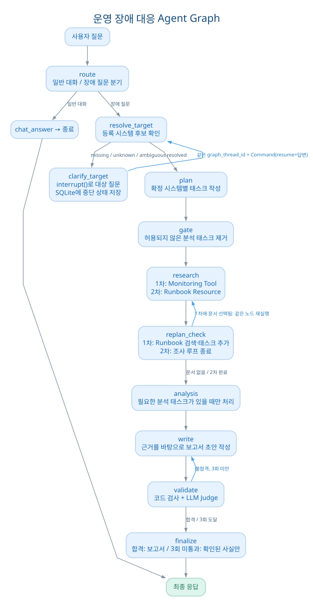
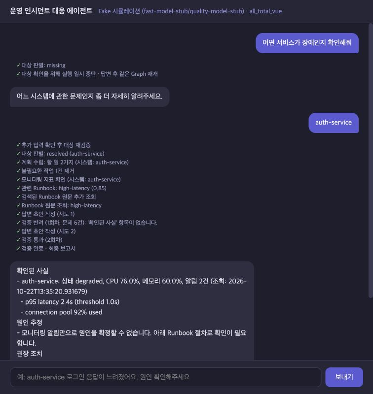
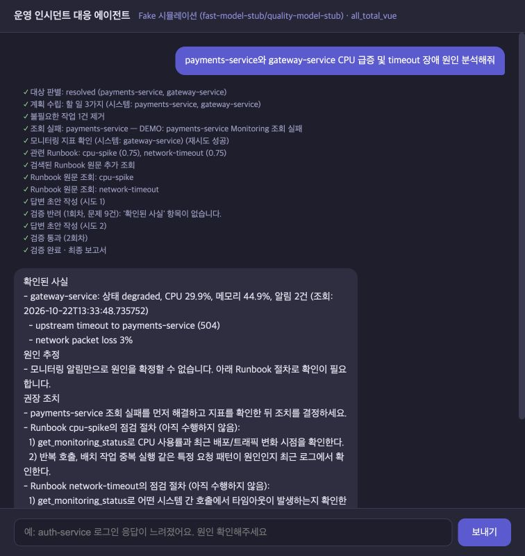
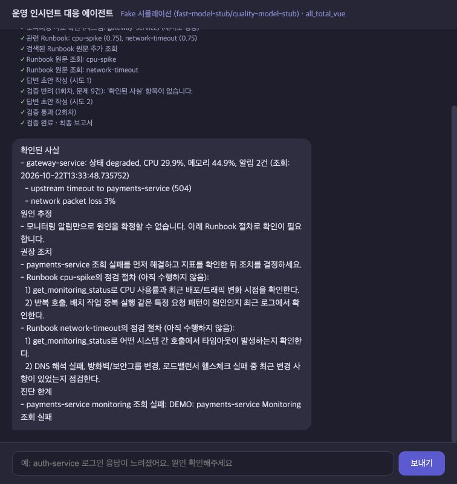

# AI 서비스 Mini-Project: 운영 장애 대응 에이전트 개선

SKALA 광주 3반 G096 정다운 · **과제 1: 기존 실습 코드 개선**

[최종 발표자료](doc/presentation/AI_서비스_Mini_project_G096_정다운_최종발표_v12.pptx) · [페이지별 발표 대본](doc/presentation_notes.md)

## 1. 선택 과제와 기존 문제

기존 FastAPI·LangGraph·MCP 실습 프로젝트를 바탕으로, 사용자의 장애 질문을 조사해 보고서를 만드는 과정을 개선했습니다. 기존 코드에는 다음 문제가 있었습니다.

| 단계 | 기존 동작과 위험 | 이번 개선 |
| --- | --- | --- |
| 조사 대상 | 시스템을 찾지 못하면 `auth-service`로 대체하거나 미등록 이름을 조회할 수 있음 | 등록된 대상인지 확인하고, 모르면 사용자에게 질문 |
| Runbook 선택 | Monitoring 결과에서 처음 맞는 영문 키워드 하나로 문서 **1개** 선택 | 질문과 경고 문구로 관련 문서를 **여러 개** 검색 |
| 보고서 검증 | `30자 이상`·`1)` 포함 여부 검사, 3회 실패 시 강제 통과 | 수집 근거와 대조하고 실패 시 안전한 답변 반환 |
| 조회 실패 | 병렬 작업 하나가 예외를 내면 다른 성공 결과도 잃을 수 있음 | 성공 결과를 보존하고 실패 대상을 명시 |
| 코드 구조 | 주요 Graph 로직이 한 파일에 집중 | 대상 확인·검색·보고서 로직 분리, 테스트·평가 추가 |

기존에도 **MCP Tool·Prompt·Resource와 의존성 주입, LangSmith 추적은 있었습니다.** 이번 작업은 MCP를 새로 도입한 것이 아니라, 그 결과를 선택·활용·검증하는 Graph 흐름을 고친 것입니다. 기존 코드 기준은 [개선 전 커밋 `2c6ad9a`](https://github.com/woonzzzang/skala-AI-agent-G096/tree/2c6ad9a)입니다.

## 2. 전체 구조



`route`가 일반 대화와 장애 질문을 구분합니다. 장애 질문이면 `resolve_target`이 조사 대상을 확정하고 `plan`이 시스템별 작업을 만듭니다. `research`는 먼저 MCP Monitoring Tool을 호출합니다. 첫 `replan_check`가 Runbook을 선택하면 **같은 `research` 노드가 다시 실행**되어 MCP Resource에서 문서 원문을 읽습니다. 두 번째 `replan_check`는 검색을 반복하지 않고 `analysis → write → validate → finalize`로 넘깁니다. 관련 문서가 없으면 두 번째 `research`는 건너뜁니다. [노드·분기 연결](agent/graph.py#L236)

발표자료 **3쪽**에는 기존 구조와 개선 구조를 한 페이지에 비교했습니다. 그림에서 `gate`는 계획과 모순되는 분석 작업을 정리하고, `analysis`는 남은 분석 작업이 있을 때만 수집 결과를 비교합니다. `replan_check`의 “충분함”은 **추가 Runbook 조회 작업이 없다는 뜻**이고, 보고서의 합격 여부는 뒤의 `validate`가 판단합니다. [계획·gate](agent/graph.py#L51) · [replan_check](agent/graph.py#L164) · [analysis](agent/graph.py#L198)

## 3. 개선 Task와 코드

### Task 1. 조사 대상을 확인하고 같은 Graph를 재개

새 [resolve_target](agent/target_nodes.py#L12)이 `monitoring.json`의 시스템명·설명을 LLM에 보여줘 후보를 받습니다. 새 [SystemRegistry](agent/system_registry.py#L103)는 후보가 **실제로 등록된 key**인지 코드로 확인합니다. Registry는 별도 DB가 아니며, 서비스 상태·CPU 같은 수치는 뒤의 MCP Tool이 조회합니다.

| 판정 | 의미 | 다음 단계 |
| --- | --- | --- |
| `resolved` | 등록된 조사 대상 확정 | `plan` 진행 |
| `missing` | 대상을 특정할 단서 부족 | 사용자에게 질문 |
| `unknown` | 등록되지 않은 시스템명 | 사용자에게 질문 |
| `ambiguous` | 둘 이상 가능하지만 확정 불가 | 사용자에게 질문 |

재질문은 [clarify_target의 `interrupt()`](agent/target_nodes.py#L46)가 담당합니다. [SQLite checkpointer](server.py#L103)가 원래 질문과 Graph 진행 상태를 보관하고, 사용자의 답이 오면 서버가 **같은 `graph_thread_id`**로 [`Command(resume=답변)`](server.py#L157)을 보냅니다. 답은 다시 Registry로 확인하며, 확정되면 **원래 장애 질문을 바꾸지 않고** 확정된 대상으로 `plan`을 계속합니다. 채팅 세션의 `thread_id`와 LangGraph 체크포인트 키인 `graph_thread_id`는 서로 다른 값입니다. 불명확하면 한 번만 묻도록 고정한 것이 아니라, 확정될 때까지 다시 질문할 수 있습니다. [재시작 후 재개 테스트](tests/test_improvements.py#L155)



### Task 2. MCP 조사 결과로 여러 Runbook 검색

**Runbook**은 장애 때 확인·조치할 절차를 적은 문서입니다. MCP 서버는 원래부터 다음 세 가지를 제공했습니다.

| MCP 요소 | 제공 내용 | Graph에서 사용하는 곳 |
| --- | --- | --- |
| [Prompt `incident_analysis_prompt`](mcp_server.py#L65) | 표준 진단 순서 | `plan`이 읽고 시스템별 Monitoring 작업 작성 |
| [Tool `get_monitoring_status`](mcp_server.py#L33) | `monitoring.json`의 상태·CPU·메모리·`alerts[]` | 첫 `research`가 확정된 시스템별로 호출 |
| [Resource `get_incident_runbook`](mcp_server.py#L56) | 선택된 Runbook의 마크다운 원문 | 두 번째 `research`가 문서별로 읽음 |

기존 `replan_check`는 Tool 결과의 `cpu`, `timeout` 같은 키워드를 순서대로 검사해 **첫 문서 하나만** 골랐습니다. 복합 장애에서는 뒤의 증상에 맞는 문서가 빠질 수 있었습니다. 지금은 [RunbookRetriever](agent/runbook_retrieval.py#L38)가 원래 질문과 성공한 Monitoring 조회의 **`alerts[]` 경고 문구**로 관련 문서 ID를 찾습니다. [replan_check](agent/graph.py#L164)가 각 문서의 pending task를 추가하고, 같은 [research](agent/graph.py#L89)가 MCP Resource에서 **원문을 읽어 `collected`에 저장**합니다. 보고서 작성은 문서 이름만 언급하지 않고 원문의 점검 절차를 권장 조치에 반영합니다. [Fake 작성 코드](agent/fake_llm.py#L220) · [실모델 작성 지시](agent/openai_llm.py#L194)

예를 들어 `payments-service`의 `CPU 91%`와 `gateway-service`의 `upstream timeout`이 함께 있으면 `cpu-spike`와 `network-timeout`을 각각 선택할 수 있습니다. Runbook의 절차는 **앞으로 확인할 권장 조치**이며, 이미 수행했다는 뜻이 아닙니다. [Monitoring 데이터](data/monitoring.json) · [네트워크 Runbook](data/runbooks/network-timeout.md)

#### 임베딩 검색과 첫 시도의 수정

OpenAI 백엔드에서는 기본적으로 [임베딩 API](agent/embeddings.py#L9)를 사용합니다. 처음에는 Runbook 본문 전체를 문서별 벡터 하나로, 질문과 모든 알림을 합쳐 질의 벡터 하나로 만들었습니다. 고정 5문항에서 정밀도·재현율이 각각 **66.7%**였습니다. 여러 Runbook에 공통인 점검 문구와 한 벡터에 섞인 복수 증상이 검색을 흐렸을 **가능성**을 보고, [현재 검색기](agent/runbook_retrieval.py#L89)는 Runbook **제목**을 임베딩하고 원래 질문과 `alerts[]`의 **각 문구**를 별도 질의로 임베딩합니다. 각 질의와 제목 벡터의 **코사인 유사도**를 계산해 문서 후보를 합친 뒤 최대 3개를 선택합니다. 선택한 문서의 전체 내용은 이후 MCP Resource에서 가져옵니다.

현재 문서는 6개여서 제목 벡터를 **서버 메모리에 캐시**하고 직접 비교합니다. 벡터 DB는 사용하지 않습니다. 문서 본문이 바뀌면 해시로 감지해 해당 제목 벡터를 다시 만듭니다. 이 방식이 벡터 DB보다 빠르다고 측정한 것은 아닙니다. [벡터 계산·캐시](agent/runbook_retrieval.py#L78) · [검색 모드 설정](server.py#L74)

### Task 3. 근거 검사와 LLM Judge

[write](agent/report_nodes.py#L12)는 보고서를 **확인된 사실 / 원인 추정 / 권장 조치 / 진단 한계**로 작성합니다. [코드 검사](agent/answer_validation.py#L24)는 수집한 자료와 시스템명·수치·Runbook 출처·조회 실패 고지를 대조합니다. OpenAI·Ollama 모드에서는 [LLM Judge](agent/openai_llm.py#L232)가 별도 호출로 초안과 Monitoring·Runbook 원문을 비교합니다. 권장 조치를 이미 실행했다고 주장하거나, 조회에 실패한 시스템의 상태를 확인된 사실처럼 쓰는 답변은 반려 대상입니다.

불합격 사유를 `write`에 전달해 최대 3회 재작성합니다. 끝내 통과하지 못하면 [finalize](agent/report_nodes.py#L48)는 미검증 초안을 강제 합격시키지 않고 확인 가능한 사실과 진단 한계를 안내합니다. **Fake 백엔드의 Judge는 규칙 기반 테스트 대역**이므로 Fake 화면을 LLM Judge 호출의 증거로 사용하지 않았습니다. 실제 API 확인은 보고서 작성·Judge 구간의 고정 사례 **1건**에 한정됩니다. [Fake Judge](agent/fake_llm.py#L275)

### Task 4. 일부 조회 실패와 진행 상태 표시

기존 병렬 조사에서는 한 Tool 호출이 예외를 내면 결과 처리 전체가 중단될 수 있었습니다. 지금은 [각 research 작업](agent/graph.py#L111)이 성공·실패를 따로 반환합니다. 성공한 Monitoring 결과는 `collected`에 유지하고, 실패한 대상과 오류는 task에 기록합니다. 보고서는 조회하지 못한 시스템을 **진단 한계**로 표시합니다. 화면은 대상 판별, 조회, Runbook 검색, 검증 이벤트를 보여줍니다. [SSE 전송](server.py#L215) · [화면 표시](web_chat.html#L118)

아래는 `payments-service` 조회만 의도적으로 실패시킨 **Fake 데모**입니다. `gateway-service`의 성공한 경고 문구와 MCP Runbook 원문의 점검 절차가 보고서에 남습니다. `payments-service`의 실제 상태는 확인되지 않았다고 밝힙니다. 첫 초안은 반려되고 두 번째 초안이 검증을 통과했습니다. 실제 운영 장애 화면이나 복구 조치 실행 화면은 아닙니다. [실패 주입 코드](scripts/demo_partial_failure.py#L24) · [회귀 테스트](tests/test_improvements.py#L188)





### Task 5. 모듈화와 평가

[Graph](agent/graph.py#L236)는 노드 등록과 분기를 담당하고, [대상 확인](agent/target_nodes.py), [검색](agent/runbook_retrieval.py), [보고서 작성·검증](agent/report_nodes.py), [상태](agent/graph_state.py), [계획 정규화](agent/task_planner.py)를 별도 모듈로 분리했습니다. [SupervisorDeps](agent/deps.py#L12)가 LLM·MCP 클라이언트·검색기를 노드에 전달합니다. 이것을 별도 프로세스의 독립 에이전트 여러 개를 둔 **Multi-Agent 구현**으로 설명하지는 않습니다.

## 4. 같은 입력의 개선 전후 결과

[고정 데이터 평가 스크립트](scripts/evaluate.py)는 **기존 Graph와 개선 Graph를 따로 실행**하고 한 평가 항목에 `before`·`after` 결과를 나란히 저장합니다. 두 실행이 상태나 기억을 공유하는 것은 아닙니다. [원본 결과 JSON](doc/evaluation_results.json)

| 입력 | 기존 | 개선 후 |
| --- | --- | --- |
| `로그인 응답이 느려요` | 일반 대화로 분류, Monitoring 0건 | `auth-service` 조사, `high-latency` Runbook 조회 |
| `payments-service와 gateway-service CPU 급증 및 timeout 장애` | `web-01`까지 3곳 조회, CPU Runbook 1개 | 지정된 2곳 조회, CPU·네트워크 Runbook 2개 |
| `billing-service 장애 원인 확인해줘` | 미등록 시스템 조회 시도 | `unknown`으로 재질문, Monitoring 0건 |


두 번째 사례의 Fake 실행 시간은 **719.8ms → 15.4ms**였습니다. 대부분은 기존 코드의 교육용 **0.35초 고정 지연 제거** 영향이며, 임베딩 속도 향상으로 해석하면 안 됩니다. 두 Graph 모두 이 사례의 최종 보고서 검증을 통과하지 못했으므로, 여기서는 **대상·문서 선택 개선**만 결과로 주장합니다.

별도로, Runbook **검색 단계만** 실제 OpenAI API로 6개 문서·고정 5문항을 측정했습니다. 기존 방식은 `gpt-4o-mini` 문서 랭킹, 수정 방식은 `text-embedding-3-small` 제목 임베딩입니다. [측정 코드](scripts/evaluate_retrieval.py#L22)

| 검색 방식 | 정밀도 | 재현율 | 5건 검색 시간 합계 |
| --- | ---: | ---: | ---: |
| 기존 LLM 문서 랭킹 | 6/7 = 85.7% | 6/6 = 100% | 9.12초 |
| 첫 임베딩: 본문 전체+합친 질의 | 66.7% | 66.7% | 별도 비교 없음 |
| 수정 임베딩: 제목+개별 알림 | 6/6 = 100% | 6/6 = 100% | 1.51초 |

**주의:** 같은 5문항을 검색 방식 조정에도 사용했으므로 독립 평가가 아닙니다. 한 번의 검색 단계 측정이며 전체 답변 시간이나 일반적인 질문에서의 정확도를 뜻하지 않습니다. OpenAI 작성·Judge 실모델 확인도 고정 사례 1건입니다.

## 5. 실행과 재현

```bash
./sh/setup_venv.sh
LANGCHAIN_TRACING_V2=false LANGSMITH_TRACING=false .venv/bin/python -B server.py
# 다른 터미널
.venv/bin/python -B web_demo_server.py
# http://127.0.0.1:8600
```

기본 Fake 모드는 API 비용이 들지 않습니다. `LLM_BACKEND=openai`이면 임베딩 검색이 기본이며 `OPENAI_API_KEY`가 필요합니다. `RUNBOOK_SEARCH_MODE=llm`로 기존 LLM 랭킹을 선택할 수 있습니다. Ollama는 LLM 랭킹이 기본이고, `ollama pull embeddinggemma` 후 `RUNBOOK_SEARCH_MODE=embedding`으로 로컬 임베딩을 선택할 수 있습니다. [서버 설정](server.py#L69)

```bash
# 단위 테스트 12개
LANGCHAIN_TRACING_V2=false LANGSMITH_TRACING=false .venv/bin/python -B -m unittest discover -s tests -v
# 고정 MCP 데이터의 기존/개선 Graph 비교
LANGCHAIN_TRACING_V2=false LANGSMITH_TRACING=false .venv/bin/python -B scripts/evaluate.py
# 실제 OpenAI API 사용·비용 발생: Runbook 검색 방식 비교
PYTHONPATH=. .venv/bin/python scripts/evaluate_retrieval.py
```

부분 실패 화면을 재현하려면 일반 서버 대신 `PYTHONPATH=. .venv/bin/python -B scripts/demo_partial_failure.py`를 실행하고, 다른 터미널에서 `.venv/bin/uvicorn web_demo_server:app --host 127.0.0.1 --port 8600`을 실행합니다. 데모는 `monitoring.json`을 수정하지 않습니다.


<details>
<summary>발표에 사용한 코드 캡처</summary>


</details>

## 6. 한계와 이후 개선

- 제목만 임베딩하므로 제목에 드러나지 않은 세부 증상은 놓칠 수 있습니다. 문서가 늘면 증상 요약·청크화·영속 인덱스·키워드 혼합 검색을 검토해야 합니다. 현재 유사도 기준도 더 많은 데이터로 조정해야 합니다.
- 제목 벡터 캐시는 서버 메모리에만 있어 재시작하면 다시 만듭니다. 새 질문·알림의 임베딩 비용도 발생합니다. SQLite 체크포인트에는 오래된 상태의 만료·정리 정책이 없습니다.
- 현재 SSE는 **검증 전 초안**을 전송할 수 있습니다. 운영용이라면 최종 검증 후 답변만 보여주도록 바꿔야 합니다. 코드·Judge 검사가 모든 사실 오류를 막는 것도 아닙니다.
- Fake 화면은 임베딩·실모델 Judge의 품질 증거가 아닙니다. 실모델 전체 Graph와 **조정에 쓰지 않은 독립 질문**으로 다시 평가해야 합니다. [현재 테스트](tests/test_improvements.py)

작은 Agent에서도 정확도와 속도, 구현 복잡성과 확장성을 함께 고려해야 했습니다. 특히 임베딩은 처음부터 좋은 결과를 주지 않았고, **실패한 검색 단위를 확인한 뒤 고쳐 다시 측정하는 과정**이 이번 개선의 핵심이었습니다.
