# 현재 프로젝트 전체 코드 개선 필요 지점

## 문서 목적

현재 프로젝트 코드를 직접 확인하면서 발견한 개선 필요 지점을 파일별로 정리한다.

문서 상단에는 이번 과제에서 실제로 진행할 개선 범위를 요약하고, 그 아래에는 코드에서
확인한 전체 개선 필요 지점을 근거 자료로 남긴다.

상세 분석에는 다음 내용만 포함한다.

1. 문제가 확인되는 실제 코드
2. 현재 코드가 수행하는 동작
3. 왜 개선 검토가 필요한지

상세 분석에는 구체적인 해결 방법과 최종 개선 방향을 포함하지 않는다. 개선 방향은 각
항목을 별도로 논의한 뒤 결정한다.

---

# 0. 이번 과제에서 진행할 개선 범위

아래 항목은 문서에서 발견한 모든 문제를 한 번에 수정한다는 의미가 아니다. 이번
Mini-Project에서 직접 구현하고 개선 전후를 비교할 범위만 추린 것이다.

## 0.1 불명확한 조사 대상 확인

관련 개선 필요점: `1.1`, `2.1`, `2.2`

- 시스템을 특정하지 못한 질문을 `auth-service`로 자동 대체하는 동작을 제거한다.
- 정확한 시스템명, `로그인`과 같은 업무 표현, 명시했지만 등록되지 않은 시스템,
  시스템 자체가 누락된 질문을 구분한다.
- 조사 대상을 확정할 수 없으면 임의의 시스템을 조회하지 않고 사용자에게 확인한다.
- 사용자가 대상을 확인하면 처음 입력한 장애 증상과 확인된 대상을 함께 사용해 분석을
  계속한다.

## 0.2 RAG 기반 다중 Runbook 검색

관련 개선 필요점: `1.4`, `1.5`, `4.6`

- 영문 키워드 규칙으로 장애 유형 하나를 결정하던 방식을 의미 기반 검색으로 개선한다.
- 사용자 질문뿐 아니라 시스템별 모니터링 상태와 알림을 함께 검색 질의에 사용한다.
- 복합 장애에서는 관련도가 높은 여러 Runbook을 검색해 함께 활용한다.
- 검색 결과가 기준을 충족하지 않으면 무관한 Runbook이나 `db-down`으로 강제 분류하지
  않고, 일치하는 Runbook이 없다는 상태를 유지한다.

## 0.3 시스템별 조사와 부분 실패 대응

관련 개선 필요점: `1.3`, `4.3`, `4.7`

- 요청에 포함된 각 시스템을 별도의 조사 단위로 관리한다.
- 일부 Monitoring 또는 Runbook 조회가 실패해도 성공한 조사 결과는 유지한다.
- 각 작업의 성공, 실패, 재시도 횟수와 실패 사유를 상태에 기록한다.
- 최종 답변에는 조회하지 못한 대상과 그로 인해 판단할 수 없는 범위를 명시한다.
- 일부 도구 실패 때문에 전체 요청이 중단되거나, 누락된 정보를 모델이 추측해서
  채우지 않도록 한다.

## 0.4 근거가 연결된 진단 보고서

관련 개선 필요점: `1.5`, `1.6`, `4.3`

- 최종 답변을 `확인된 사실`, `원인 추정`, `권장 조치`, `진단 한계`로 구분한다.
- 확인된 사실에는 시스템명, 모니터링 수치, 알림과 조회 시각을 연결한다.
- 원인 추정과 권장 조치에는 참고한 Runbook의 이름과 관련 내용을 연결한다.
- 수집하지 못한 값이나 출처가 없는 내용을 사실처럼 작성하지 않도록 한다.

## 0.5 사실 검증과 재작성 강화

관련 개선 필요점: `1.6`, `1.7`

- 기존의 글자 수와 `1)` 포함 여부뿐 아니라 시스템명, 수치, 알림, Runbook 출처가
  수집 결과와 일치하는지 검사한다.
- 사실과 추정이 구분됐는지, 실패한 조사 대상을 정상 조회한 것처럼 표현하지 않았는지
  확인한다.
- 검증에 실패하면 구체적인 반려 사유를 전달해 답변을 다시 작성한다.
- 정해진 횟수만큼 재작성해도 실패하면 강제로 합격시키지 않고, 검증 미통과 사실과
  현재 확인 가능한 사실만 사용자에게 제공한다.

## 0.6 처리 과정과 근거 시각화

관련 개선 필요점: `6.4`, `6.5`, `6.7`

- 기존 채팅 화면에 시스템별 조사 상태와 성공·실패 결과를 표시한다.
- 검색된 Runbook과 최종 보고서에서 사용된 참고 근거를 표시한다.
- Validator의 통과 여부, 반려 사유와 재작성 횟수를 확인할 수 있게 한다.
- 검증 전 초안과 검증을 마친 최종 보고서가 혼동되지 않도록 화면 상태를 구분한다.

## 0.7 개선 전후 자동 평가와 단위 테스트

관련 개선 필요점: `4.5`, `7.1`

- 동일한 질문과 고정된 Monitoring 데이터로 기존 버전과 개선 버전을 반복 실행한다.
- 대상 시스템 인식 정확도, Runbook 검색 정확도, 수치·출처 일치율, 부분 실패 처리율과
  전체 처리 시간을 비교한다.
- 자연어 대상 표현, 미등록 시스템, 대상 누락, 복수 시스템과 복합 장애를 평가 데이터에
  포함한다.
- Target 해석, RAG 검색, Validator와 부분 실패 처리는 각각 단위 테스트를 작성한다.
- 평가 결과는 이후 발표에서 Before/After 근거로 사용할 수 있도록 파일로 저장한다.

## 0.8 Graph 및 공통 로직 모듈화

관련 개선 필요점: `1.8`, `2.1`, `2.2`

- Target 해석, Runbook 검색, 보고서 구성과 검증 로직을 역할별 모듈로 분리한다.
- Ollama와 OpenAI 구현에 중복된 시스템 목록 로드와 Plan 결과 정규화 코드를 공통화한다.
- `agent/graph.py`는 세부 판정 로직을 직접 모두 가지지 않고 노드 연결과 상태 흐름을
  중심으로 관리한다.
- provider별 LLM 파일은 모델 호출 방식의 차이만 담당하도록 범위를 줄인다.

## 이번 개선 범위에서 제외하는 항목

세션 저장 구조, OpenAI HTTP 비동기화, API 인증·Rate Limit, Vue CDN 버전, Proxy 주소,
의존성 버전과 배포 설정 문제는 현재 코드의 개선 필요점으로 계속 기록하되 이번
Mini-Project의 핵심 구현 범위에서는 제외한다.

---

# 1. `agent/graph.py`

`agent/graph.py`는 라우팅부터 최종 답변 검증까지 전체 Agent 흐름을 담당하는 핵심 파일이다.

## 1.1 시스템명을 찾지 못하면 `auth-service`로 처리함

코드 위치: [`agent/graph.py` 26~47행](../agent/graph.py#L26-L47)

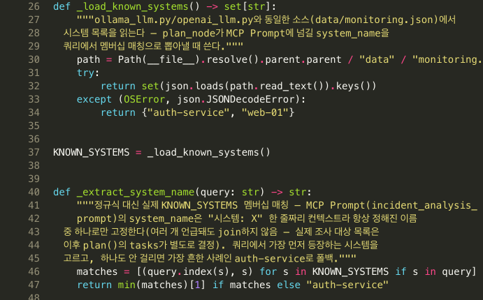

### 현재 동작

- `data/monitoring.json`에서 알려진 시스템 목록을 읽는다.
- 파일을 읽지 못하면 `auth-service`, `web-01`만 사용한다.
- 질문에서 알려진 시스템을 찾지 못하면 `auth-service`를 반환한다.
- 시스템 목록은 모듈 import 시점에 `KNOWN_SYSTEMS` 전역 상수로 만들어진다.

#### 2.1 과도 연관

### 왜 개선 검토가 필요한가

- `billing-service`처럼 등록되지 않은 시스템이 `auth-service`로 바뀔 수 있다.
- 시스템명이 생략된 요청과 알 수 없는 시스템을 명시한 요청을 구분하지 않는다.
- 잘못 선택된 시스템이 MCP Prompt와 이후 진단 과정에 전달될 수 있다.
- 모니터링 파일 읽기 실패가 외부에 드러나지 않고 기본값으로 조용히 대체된다.
- 서버 실행 중 `monitoring.json`의 시스템 목록이 바뀌어도 `KNOWN_SYSTEMS`는 갱신되지 않는다.
- 이후 파이프라인이 정상적으로 실행되므로 잘못된 대상이 자연스러운 진단처럼 보일 수 있다.

---

## 1.2 Research task마다 0.35초 고정 지연이 있음

## 1.3 병렬 task 중 하나가 실패하면 전체 Research가 실패할 수 있음

코드 위치: [`agent/graph.py` 137~186행](../agent/graph.py#L137-L186)

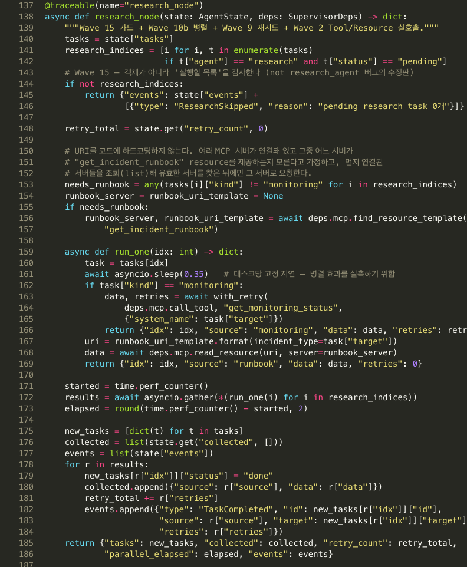

### 현재 동작

- 각 Research task는 실행 전에 항상 `asyncio.sleep(0.35)`를 수행한다.
- 여러 task를 `asyncio.gather()`로 한 번에 실행한다.
- 성공한 결과는 monitoring 또는 runbook 형태로 `collected`에 추가한다.
- task 상태는 `pending`에서 `done`으로 변경된다.

### 왜 개선 검토가 필요한가

- task가 하나뿐이어도 최소 0.35초의 인위적인 지연이 추가된다.
- 실제 MCP 처리 속도와 관계없이 모든 장애 진단이 느려진다.
- 병렬 성능 측정값에 시연용 지연이 포함되어 실제 성능을 판단하기 어렵다.
- `asyncio.gather()`에 전달된 task 하나가 예외를 발생시키면 나머지 성공 결과까지 반영되지 않을 수 있다.
- task별 실패 상태와 오류 정보가 별도로 저장되지 않는다.
- monitoring과 runbook 응답 구조가 예상과 다르면 후속 코드에서 런타임 오류가 발생할 수 있다.
- task 수가 많아져도 동시 실행 개수에 제한이 없다.

---

## 1.4 장애 유형을 영문 키워드로만 분류함

## 1.5 Replan 충분성 판단이 Runbook 존재 여부에만 의존함

코드 위치: [`agent/graph.py` 189~230행](../agent/graph.py#L189-L230)

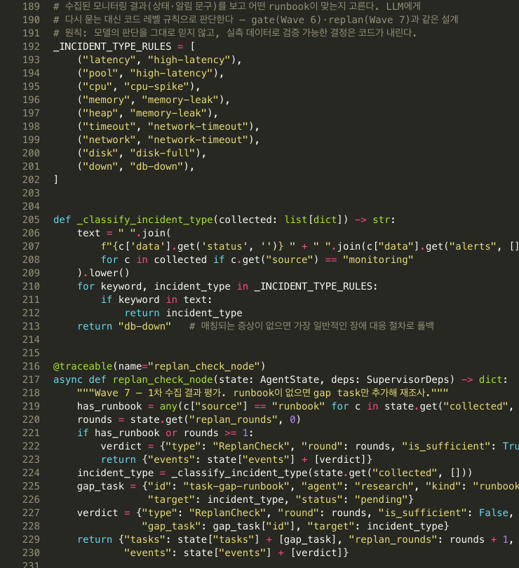

### 현재 동작

장애 유형은 다음 키워드를 순서대로 확인해 결정한다.

```text
latency, pool → high-latency
cpu → cpu-spike
memory, heap → memory-leak
timeout, network → network-timeout
disk → disk-full
down → db-down
```

키워드를 찾지 못하면 `db-down`을 반환한다.

Replan 여부는 수집 결과에 runbook이 있는지 확인해 결정한다. 한 번 재계획한 뒤에는 여전히 runbook이 없어도 정보가 충분한 것으로 처리한다.

### 왜 개선 검토가 필요한가

- 등록된 영문 단어가 정확히 들어 있어야 분류된다.
- 유사한 한국어 표현과 도메인 동의어를 놓칠 수 있다.
- 여러 증상이 동시에 존재하면 규칙의 순서가 결과에 영향을 준다.
- Runbook 본문의 의미와 실제 대응 절차는 분류 근거로 사용되지 않는다.
- 분류할 수 없는 장애를 `db-down`으로 확정할 근거가 없다.
- 관련 없는 runbook이 하나만 있어도 충분한 조사로 판단할 수 있다.
- 요청에 언급된 모든 시스템을 조회했는지 확인하지 않는다.
- 원인을 설명할 실제 수치가 확보됐는지 확인하지 않는다.
- 재계획 상한 도달과 정보 충분을 동일하게 취급하고 있다.

---

## 1.6 답변 검증이 길이와 `1)` 문자열만 확인함

## 1.7 세 번 실패하면 품질과 관계없이 강제 합격함

코드 위치: [`agent/graph.py` 254~288행](../agent/graph.py#L254-L288)

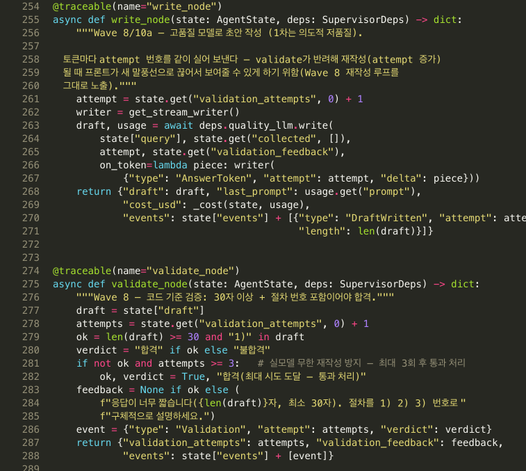

### 현재 동작

Validator의 합격 기준은 다음 두 가지다.

```python
len(draft) >= 30
"1)" in draft
```

세 번째 검증에서도 불합격이면 다음과 같이 강제로 합격 처리한다.

```python
ok, verdict = True, "합격(최대 시도 도달 — 통과 처리)"
```

### 왜 개선 검토가 필요한가

- 질문과 무관한 긴 답변도 통과할 수 있다.
- 모니터링에서 수집하지 않은 수치를 만들어도 탐지하지 못한다.
- 실제 수치와 답변의 인용 수치가 일치하는지 확인하지 않는다.
- 원인, 근거, 권장 조치가 누락돼도 통과할 수 있다.
- `1)`만 존재하고 `2)`, `3)`이 없어도 합격할 수 있다.
- 위험한 조치가 근거 없이 포함돼도 확인하지 않는다.
- 세 번째 결과가 여전히 잘못돼 있어도 정상 답변처럼 사용자에게 전달된다.
- 강제 합격이 LangSmith나 평가 결과에서 정상 합격과 구분되지 않을 수 있다.

---

## 1.8 모든 Graph 노드가 한 파일에 집중돼 있음

코드 위치: [`agent/graph.py` 310~338행](../agent/graph.py#L310-L338)

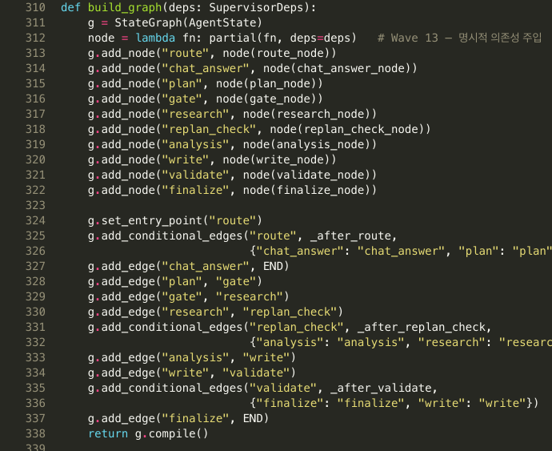

### 현재 동작

다음 노드의 구현과 연결이 모두 `agent/graph.py`에 들어 있다.

- route
- chat_answer
- plan
- gate
- research
- replan_check
- analysis
- write
- validate
- finalize

### 왜 개선 검토가 필요한가

- 그래프 연결 구조와 개별 노드의 세부 로직이 한 파일에 섞여 있다.
- 특정 노드만 수정해도 전체 상태와 분기 구조를 함께 이해해야 한다.
- 노드별 단위 테스트 범위를 분리하기 어렵다.
- RAG, 승인, 로그 분석 같은 노드가 추가되면 파일이 더 커진다.
- 여러 사람이 같은 파일을 수정할 가능성이 높아 충돌 위험이 커진다.
- 역할별 책임과 경계를 파일 구조만으로 파악하기 어렵다.

---

# 2. LLM 구현 계층

대상 파일:

- `agent/ollama_llm.py`
- `agent/openai_llm.py`
- `agent/fake_llm.py`

## 2.1 Ollama와 OpenAI에 동일한 시스템 처리 코드가 중복됨

Ollama 코드: [`agent/ollama_llm.py` 23~55행](../agent/ollama_llm.py#L23-L55)

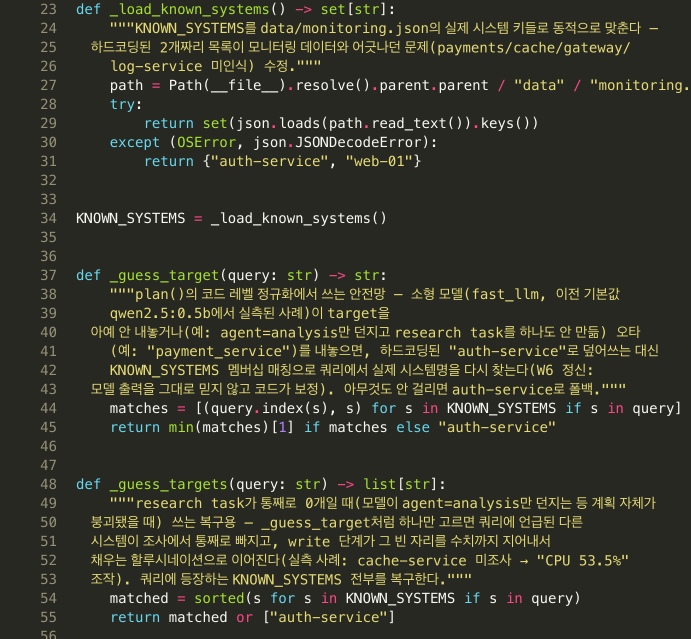

OpenAI 코드: [`agent/openai_llm.py` 32~62행](../agent/openai_llm.py#L32-L62)

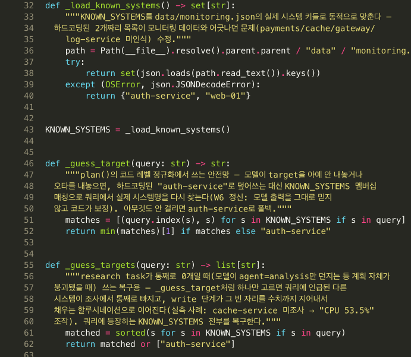

### 현재 동작

두 파일이 각각 다음 로직을 별도로 가지고 있다.

- `monitoring.json`에서 시스템 목록 로드
- 시스템 탐지 실패 시 `auth-service` 사용
- 질문에 등장한 복수 시스템 복구

### 왜 개선 검토가 필요한가

- 동일한 버그를 두 파일에서 각각 수정해야 한다.
- 한쪽만 수정하면 Ollama와 OpenAI의 결과가 달라질 수 있다.
- 시스템 탐지 정책이 LLM provider 구현과 강하게 결합돼 있다.
- 테스트도 provider마다 같은 사례를 반복해야 한다.
- 시스템 목록은 두 파일 모두 import 시점에 한 번만 로드한다.
- 기본 시스템인 `auth-service`가 여러 위치에 반복해서 하드코딩돼 있다.

---

## 2.2 Plan 결과 정규화 코드도 provider별로 중복됨

Ollama 코드: [`agent/ollama_llm.py` 170~215행](../agent/ollama_llm.py#L170-L215)

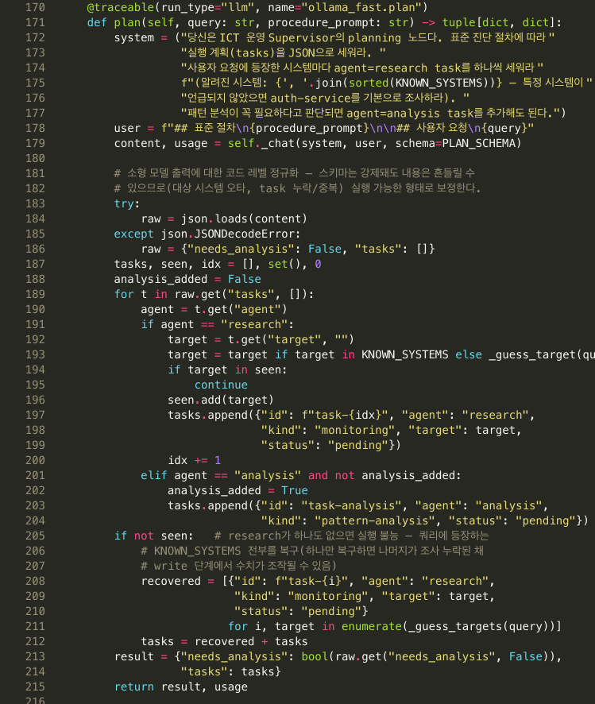

OpenAI 코드: [`agent/openai_llm.py` 132~178행](../agent/openai_llm.py#L132-L178)

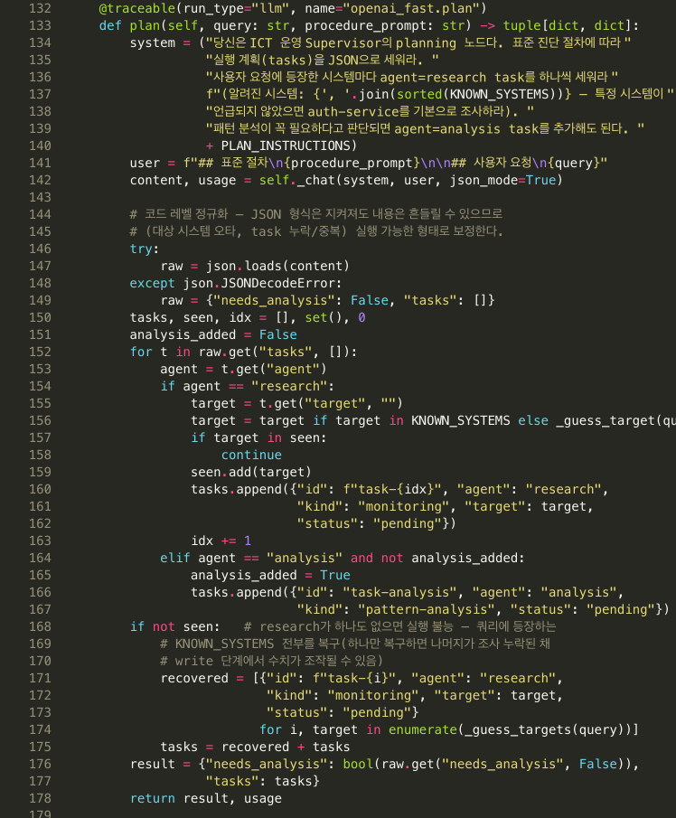

### 현재 동작

두 provider가 각각 다음 작업을 수행한다.

- LLM JSON 파싱
- research와 analysis task 구분
- 알 수 없는 시스템명을 기본 시스템으로 보정
- 중복 task 제거
- research task가 없으면 질문에서 시스템을 다시 추출
- task ID, kind, status 생성

### 왜 개선 검토가 필요한가

- 사실상 동일한 비즈니스 규칙이 두 파일에 복제돼 있다.
- provider 변경이 실행 계획의 의미까지 바꾸게 된다.
- 새로운 task 유형을 추가할 때 두 구현을 동시에 수정해야 한다.
- 두 구현 사이에 작은 차이가 생겨도 발견하기 어렵다.
- Plan 검증 책임과 LLM API 호출 책임이 한 클래스에 함께 들어 있다.
- 잘못된 target을 `auth-service`로 바꾸는 기존 위험이 반복된다.

---

## 2.3 OpenAI 호출이 동기 HTTP 방식임

코드 위치: [`agent/openai_llm.py` 76~105행](../agent/openai_llm.py#L76-L105)

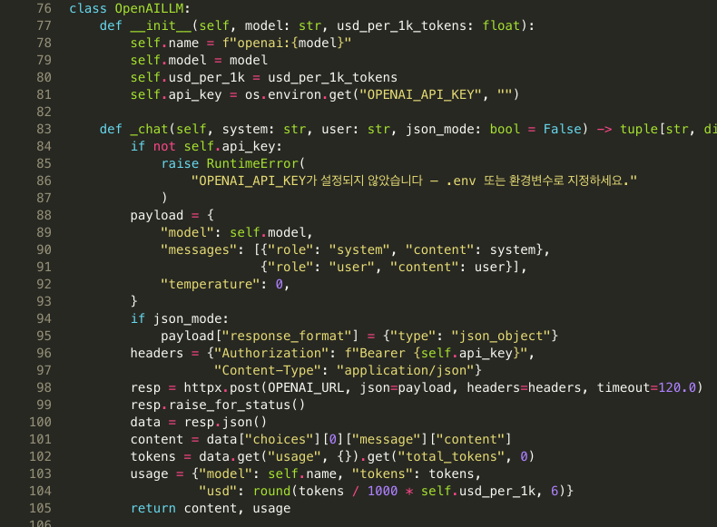

### 현재 동작

OpenAI API를 `httpx.post()`로 호출한다. 이 함수는 동기 함수이며 async graph 노드 안에서 사용된다.

### 왜 개선 검토가 필요한가

- HTTP 응답을 기다리는 동안 이벤트 루프를 막을 수 있다.
- 동시에 처리 중인 다른 사용자 요청까지 지연될 수 있다.
- graph에서 `asyncio.gather()`를 사용해도 내부 동기 호출이 병렬 효과를 제한한다.
- 요청마다 별도의 HTTP 연결을 만들기 때문에 연결 재사용 효과가 없다.
- Ollama의 비스트리밍 호출도 동일한 동기 호출 구조를 사용한다.
- 동시 요청 수가 늘어날수록 p95 응답시간이 급격히 증가할 가능성이 있다.

---

## 2.4 OpenAI의 async 함수가 실제 토큰 스트리밍을 하지 않음

코드 위치: [`agent/openai_llm.py` 191~238행](../agent/openai_llm.py#L191-L238)

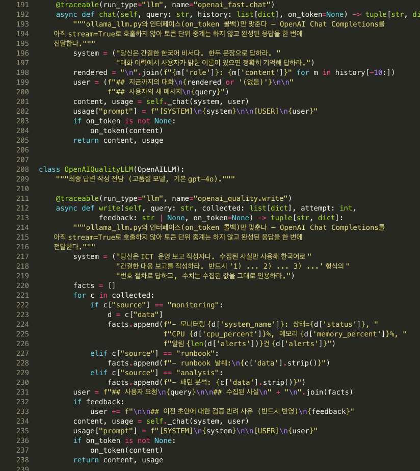

### 현재 동작

- `chat()`과 `write()`는 `async def`로 선언돼 있다.
- 내부에서는 동기 `_chat()`이 전체 응답을 받을 때까지 기다린다.
- 전체 응답이 완성된 뒤 `on_token(content)`를 한 번 호출한다.

### 왜 개선 검토가 필요한가

- 사용자는 답변이 생성되는 동안 아무 토큰도 받지 못한다.
- SSE에서는 토큰 스트리밍처럼 보이지만 실제로는 완성된 답변 한 덩어리가 전달된다.
- 첫 토큰 도착시간과 전체 완료시간이 동일해질 수 있다.
- Ollama와 OpenAI의 streaming 사용자 경험이 서로 다르다.
- 함수 선언이 async라는 사실만으로 실제 비동기 I/O가 보장되지 않는다.

---

## 2.5 Fake LLM이 첫 답변을 의도적으로 나쁘게 생성함

코드 위치: [`agent/fake_llm.py` 93~105행](../agent/fake_llm.py#L93-L105)

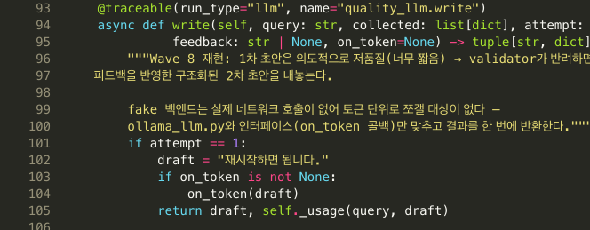

### 현재 동작

첫 번째 Writing 시도에서는 항상 `재시작하면 됩니다.`라는 짧은 답변을 반환한다. Validator 재작성 흐름을 보여주기 위한 시연 코드다.

### 왜 개선 검토가 필요한가

- 첫 번째 검증 실패가 실제 모델 품질이 아니라 코드에 의해 강제로 발생한다.
- validation attempt, 비용, 지연시간 통계가 시연 로직의 영향을 받는다.
- Fake backend 평가 결과를 실제 개선 전후 결과로 사용하기 어렵다.
- 같은 입력에서 일부러 실패하도록 설계돼 정상 품질 Baseline이 되지 못한다.
- 실습용 동작과 평가용 동작의 경계가 코드상 명확하지 않다.

---

## 2.6 비용 계산이 단일 가상 단가로 단순화돼 있음

### 현재 동작

OpenAI와 Ollama 모두 입력·출력 토큰을 구분하지 않고 전체 토큰 수에 하나의 `usd_per_1k_tokens`를 곱한다. Ollama도 실제 비용이 아닌 가상 단가를 사용한다.

### 왜 개선 검토가 필요한가

- 표시되는 `cost_usd`가 실제 OpenAI 청구 금액과 다를 수 있다.
- 입력 토큰과 출력 토큰 단가 차이가 반영되지 않는다.
- Ollama의 값은 실제 비용이 아니라 비교용 지표이지만 API 응답에서는 같은 이름으로 표시된다.
- 모델별 비용 비교 결과를 실제 비용으로 오해할 가능성이 있다.

---

# 3. `agent/session_store.py`

코드 위치: [`agent/session_store.py` 10~37행](../agent/session_store.py#L10-L37)

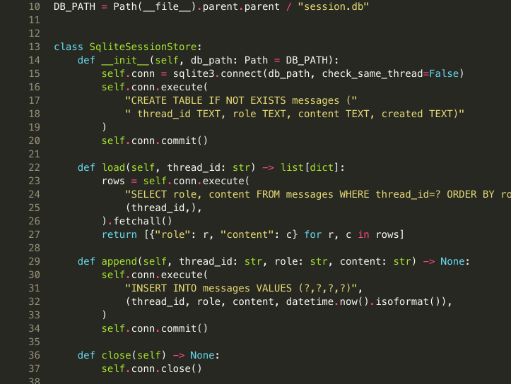

## 3.1 대화 전체를 제한 없이 불러옴

### 현재 동작

같은 `thread_id`의 모든 메시지를 `ORDER BY rowid`로 조회해 전부 반환한다.

### 왜 개선 검토가 필요한가

- 대화가 길어질수록 DB 조회량이 계속 증가한다.
- LLM에 전달되는 Prompt 크기와 토큰 비용이 계속 증가한다.
- 모델 Context Window를 초과할 가능성이 있다.
- 오래된 불필요한 대화와 중요한 정보가 구분되지 않는다.
- 요약, 압축, 최근 N턴 유지 같은 Context 관리가 없다.

## 3.2 동기 SQLite 호출을 async 요청 처리에서 사용함

### 현재 동작

`sqlite3`의 동기 `execute()`, `fetchall()`, `commit()`을 사용한다.

### 왜 개선 검토가 필요한가

- DB 작업 중 FastAPI 이벤트 루프가 블로킹될 수 있다.
- 긴 세션 조회나 디스크 지연이 다른 요청 처리에도 영향을 줄 수 있다.

## 3.3 하나의 SQLite connection을 모든 요청이 공유함

### 현재 동작

`check_same_thread=False`로 만든 하나의 connection을 서버 전체에서 공유한다. 별도의 Lock이나 transaction 관리가 없다.

### 왜 개선 검토가 필요한가

- 동시 요청이 같은 connection에 접근할 수 있다.
- 한 턴의 user 메시지와 assistant 메시지가 별도 commit으로 저장된다.
- 두 번째 저장이 실패하면 한 턴이 절반만 기록될 수 있다.
- 다중 프로세스 또는 다중 인스턴스 환경에서 파일 Lock 경합이 생길 수 있다.

## 3.4 세션 운영 정책이 없음

### 확인된 항목

- `thread_id` 인덱스가 없다.
- 세션 삭제 API가 없다.
- 보존 기간과 만료 정책이 없다.
- 사용자별 접근 구분이 없다.
- 메시지는 평문으로 저장된다.
- `created` 값은 저장하지만 조회와 정리에 사용하지 않는다.

### 왜 개선 검토가 필요한가

세션이 누적될수록 조회 성능, 개인정보 보존, 데이터 삭제, 사용자 간 격리 문제가 발생할 수 있다.

---

# 4. MCP와 재시도 계층

## 4.1 최초 MCP Tool 호출을 의도적으로 실패시킴

## 4.2 모든 MCP 호출을 하나의 Lock으로 직렬화함

코드 위치: [`agent/mcp_client.py` 44~77행](../agent/mcp_client.py#L44-L77)

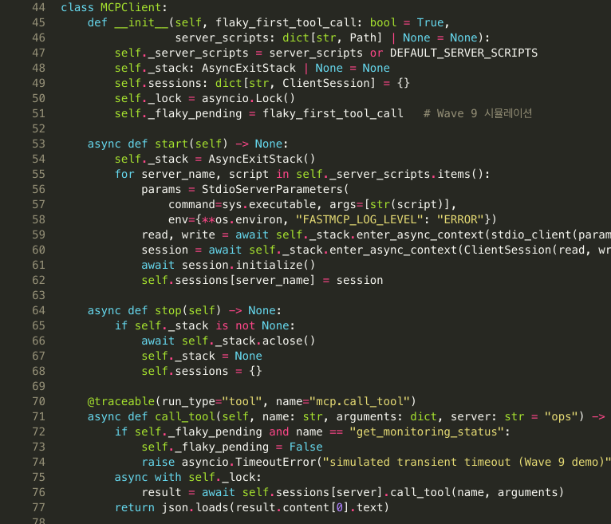

### 현재 동작

- `flaky_first_tool_call=True`가 기본값이다.
- 최초 `get_monitoring_status` 호출은 항상 `TimeoutError`를 발생시킨다.
- 모든 MCP session 호출에 하나의 `self._lock`을 사용한다.

### 왜 개선 검토가 필요한가

- 정상 운영에서도 첫 호출은 반드시 실패한다.
- retry 횟수와 지연시간이 실제 장애가 아니라 시연 코드에 의해 증가한다.
- ops 서버와 docs 서버처럼 서로 다른 MCP 서버 호출도 같은 Lock을 기다린다.
- graph에서 task를 병렬로 실행해도 MCP 호출 구간은 직렬화된다.
- task 수가 늘어날수록 Lock 대기시간이 증가한다.

---

## 4.3 MCP 응답 구조를 고정적으로 가정함

## 4.4 서버 시작 도중 실패했을 때 부분 연결 정리가 불명확함

코드 위치: [`agent/mcp_client.py` 79~122행](../agent/mcp_client.py#L79-L122)

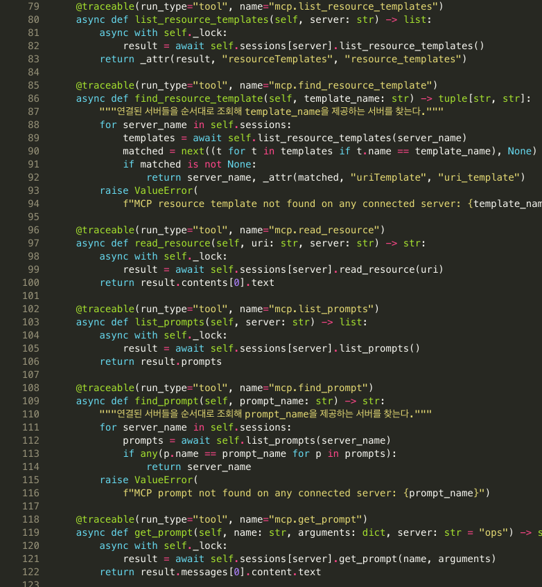

### 현재 동작

- Tool 응답의 첫 번째 content가 text라고 가정한다.
- Resource 응답의 첫 번째 contents가 text라고 가정한다.
- Prompt 응답의 첫 번째 message content가 text라고 가정한다.
- 연결된 서버를 순서대로 조회해 Resource와 Prompt를 찾는다.

### 왜 개선 검토가 필요한가

- 응답이 비어 있으면 index 오류가 발생할 수 있다.
- text 이외의 content type이 오면 처리하지 못한다.
- MCP Tool이 오류 결과를 반환했는지 명확히 확인하지 않는다.
- 지정한 server key가 없으면 그대로 KeyError가 발생한다.
- 여러 서버가 같은 이름의 capability를 제공하면 첫 번째 결과만 사용한다.
- `start()` 중 두 번째 서버 연결이 실패하면 이미 시작한 첫 번째 서버의 정리 흐름이 호출자에게 보장되지 않는다.
- capability 탐색 실패가 사용자에게 어떤 형태로 전달되는지 표준이 없다.

---

## 4.5 모니터링 값이 호출할 때마다 무작위로 달라짐

## 4.6 Runbook은 정확한 파일명으로만 조회됨

코드 위치: [`mcp_server.py` 33~62행](../mcp_server.py#L33-L62)

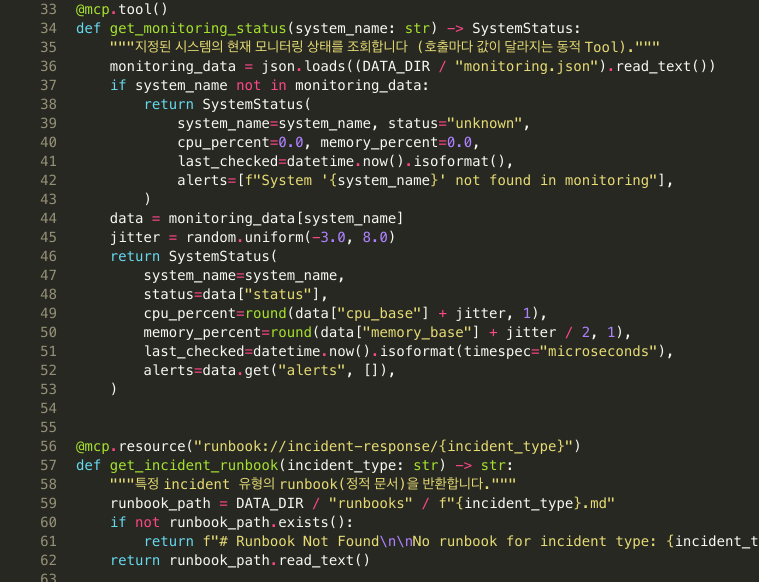

### 현재 동작

- monitoring Tool이 호출될 때마다 `monitoring.json`을 다시 읽는다.
- CPU와 Memory에 무작위 jitter를 더한다.
- Runbook은 `incident_type.md` 파일을 정확히 지정해야 읽을 수 있다.
- 파일이 없으면 오류가 아니라 `Runbook Not Found` 문자열을 정상 Resource처럼 반환한다.

### 왜 개선 검토가 필요한가

- 같은 질문으로 Before/After 테스트를 해도 모니터링 수치가 달라진다.
- 수치 인용 정확도 평가가 매 실행마다 흔들릴 수 있다.
- 파일 I/O가 모든 monitoring 호출마다 반복된다.
- 자연어 증상과 의미적으로 가까운 Runbook을 찾지 못한다.
- Runbook이 없다는 상태가 정상 문서 응답과 구분되지 않는다.
- 잘못된 incident type이 후속 Writing 단계까지 정상 근거처럼 전달될 수 있다.

---

## 4.7 Retry 대상이 `asyncio.TimeoutError` 하나뿐임

코드 위치: [`agent/retry.py` 10~22행](../agent/retry.py#L10-L22)

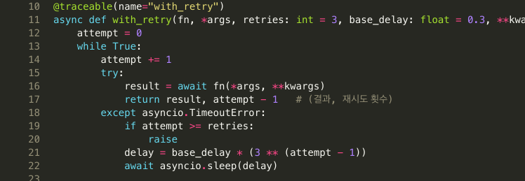

### 현재 동작

- `asyncio.TimeoutError`만 재시도한다.
- 최대 시도 횟수와 3배 증가하는 backoff를 사용한다.
- 그 외 예외는 원래 예외 그대로 호출자에게 전달한다.

### 왜 개선 검토가 필요한가

- HTTP 429, 502, 503이나 연결 재설정 같은 다른 일시 오류는 구분하지 않는다.
- 재시도 간격에 jitter가 없어 여러 요청이 동시에 다시 몰릴 수 있다.
- 최종 실패를 프로젝트 공통 오류 타입으로 변환하지 않는다.
- 어떤 Tool에서 몇 번째 시도에 실패했는지 오류 객체에 포함되지 않는다.
- timeout이 발생한 작업의 취소와 자원 정리 여부는 호출 함수에 의존한다.

---

# 5. `server.py`

## 5.1 알 수 없는 LLM backend가 fake 모델로 조용히 전환됨

코드 위치: [`server.py` 40~59행](../server.py#L40-L59)

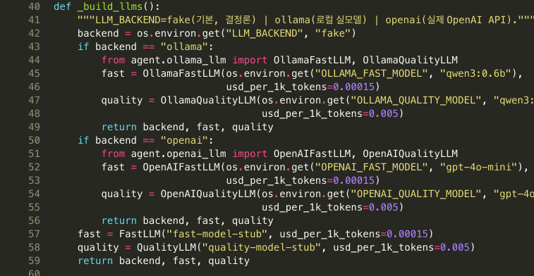

### 현재 동작

`LLM_BACKEND`가 `ollama` 또는 `openai`가 아니면 모두 fake 모델을 생성한다. 반환되는 backend 이름은 입력된 문자열을 그대로 사용한다.

### 왜 개선 검토가 필요한가

- 환경변수 오타가 있어도 서버가 정상 기동된다.
- 사용자는 실모델을 사용한다고 생각하지만 fake 모델이 실행될 수 있다.
- health 응답의 backend 이름과 실제 모델 구현이 서로 다를 수 있다.
- 잘못된 운영 설정을 조기에 발견하기 어렵다.

`SUPERVISOR_VERSION`도 `v2`가 아니면 모두 v1 경로로 처리되므로 비슷한 문제가 있다.

---

## 5.2 Lifespan 시작 도중 실패할 때 정리 흐름이 취약함

코드 위치: [`server.py` 62~87행](../server.py#L62-L87)

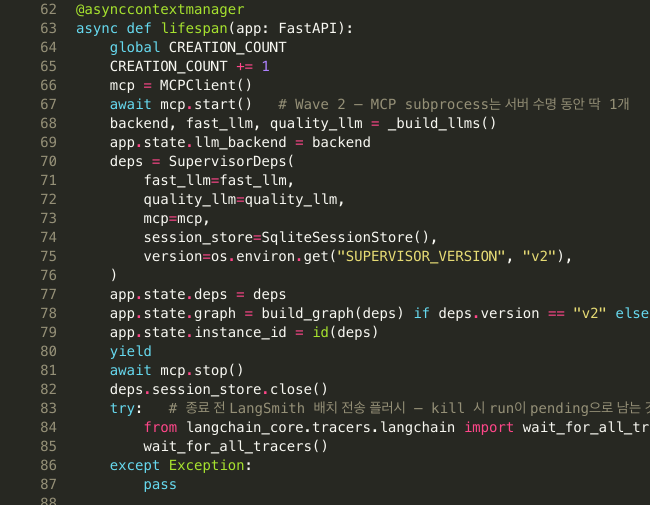

### 현재 동작

- MCPClient를 시작한다.
- LLM과 SessionStore를 생성한다.
- `yield` 이후 MCP와 SessionStore를 종료한다.
- LangSmith tracer flush 오류는 모두 무시한다.

### 왜 개선 검토가 필요한가

- MCP 시작 후 LLM 또는 SessionStore 생성이 실패하면 `yield` 이후 정리 코드에 도달하지 못할 수 있다.
- 일부 MCP subprocess만 시작된 상태로 startup이 실패할 가능성이 있다.
- tracer flush 실패를 완전히 무시해 추적 데이터 유실을 알 수 없다.
- 환경변수와 외부 의존성 검증이 startup 단계에서 명시적으로 드러나지 않는다.

---

## 5.3 Chat 성공 이후에만 세션을 저장함

코드 위치: [`server.py` 125~145행](../server.py#L125-L145)

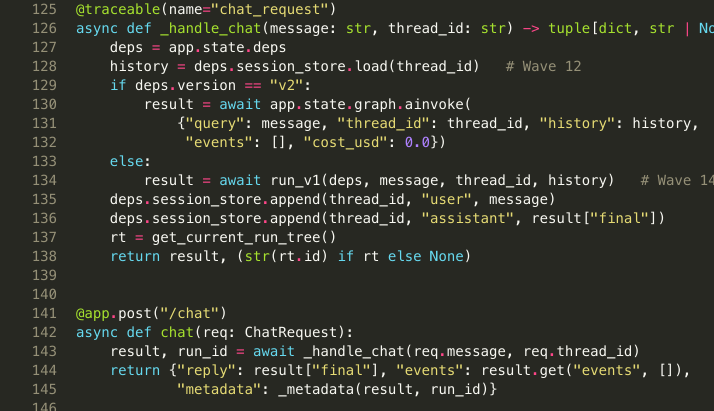

### 현재 동작

- history를 먼저 불러온다.
- graph 또는 v1 supervisor 실행이 끝난 뒤 user와 assistant 메시지를 저장한다.
- user 메시지와 assistant 메시지를 별도 DB commit으로 기록한다.

### 왜 개선 검토가 필요한가

- graph 실행이 실패하면 사용자가 어떤 요청을 했는지 기록되지 않는다.
- user 저장 성공 후 assistant 저장이 실패하면 불완전한 대화 턴이 생길 수 있다.
- 동일 thread에 동시 요청이 들어올 때 메시지 순서를 보장하는 별도 정책이 없다.
- 저장 실패가 API 응답과 어떻게 연결되는지 정의돼 있지 않다.

---

## 5.4 SSE가 사용자 메시지를 GET URL로 전달함

## 5.5 v1 streaming 경로는 세션을 저장하지 않음

## 5.6 Client 연결 종료와 streaming 오류 처리가 없음

코드 위치: [`server.py` 148~192행](../server.py#L148-L192)

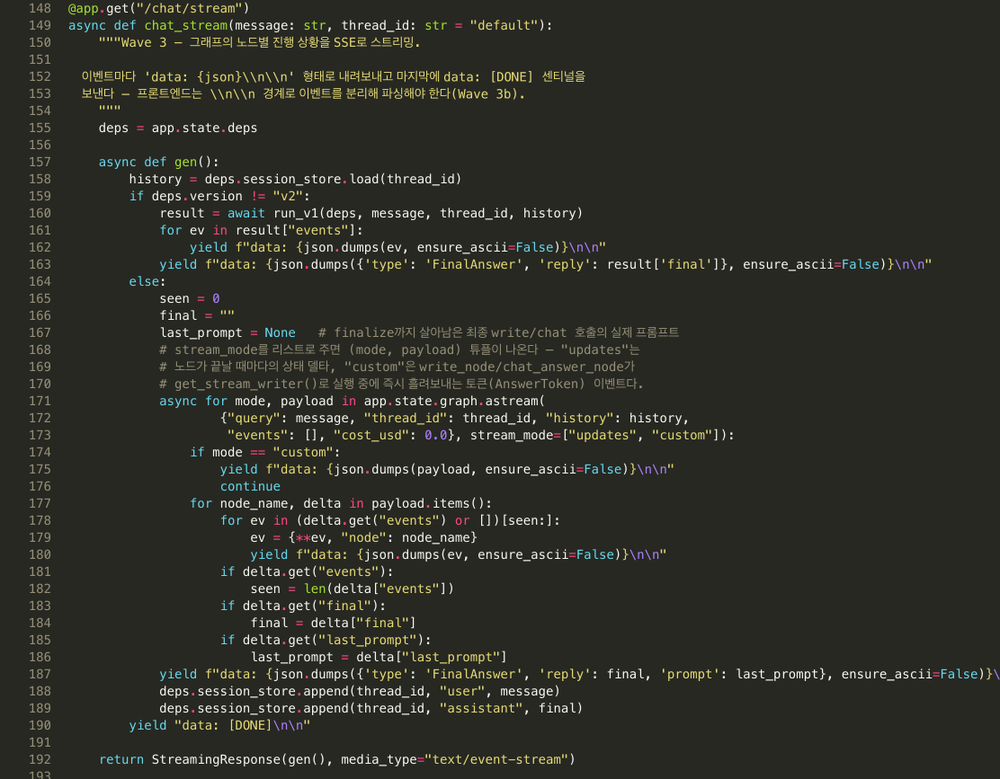

### 현재 동작

- `/chat/stream?message=...&thread_id=...` 형태의 GET endpoint를 사용한다.
- v1은 이벤트와 최종 답변을 전송한다.
- v2만 streaming 종료 후 session에 메시지를 저장한다.
- 최종 SSE 이벤트에 최종 Prompt를 포함한다.

### 왜 개선 검토가 필요한가

- 사용자 질문이 URL, 브라우저 기록, 프록시 로그에 남을 수 있다.
- 긴 질문은 URL 길이 제한의 영향을 받을 수 있다.
- v1과 v2의 세션 기억 동작이 다르다.
- Client가 브라우저를 닫아도 graph 실행이 계속될 수 있다.
- generator 내부 오류를 표준 SSE 오류 이벤트로 전달하지 않는다.
- streaming 응답에는 `/chat` 응답과 같은 metadata가 충분히 포함되지 않는다.
- 최종 Prompt가 브라우저까지 전달되어 내부 지시와 수집 데이터가 노출될 수 있다.

---

## 5.7 API 보호와 공통 오류 응답이 없음

### 확인된 항목

- 인증 또는 사용자 식별이 없다.
- 요청 횟수 제한이 없다.
- 입력 메시지 크기 제한이 없다.
- endpoint별 예외를 공통 오류 모델로 변환하지 않는다.
- 운영 정보가 포함된 health endpoint가 공개돼 있다.

### 왜 개선 검토가 필요한가

외부 접근이 가능한 환경에서는 비용 남용, 세션 혼용, 내부 구성 노출, 일관되지 않은 500 응답 문제가 생길 수 있다.

---

# 6. Frontend와 Proxy

## 6.1 Vue CDN 버전이 고정돼 있지 않음

## 6.2 fake backend도 `실모델`로 표시함

## 6.3 새로고침마다 새로운 thread가 생성됨

코드 위치: [`web_chat.html` 113~141행](../web_chat.html#L113-L141)

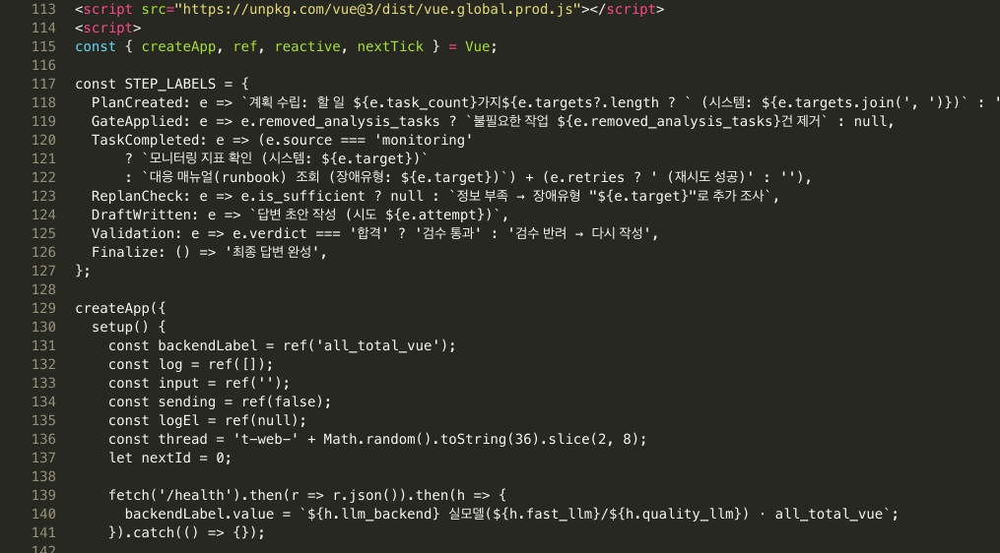

### 현재 동작

- `https://unpkg.com/vue@3/dist/vue.global.prod.js`에서 Vue를 가져온다.
- thread ID를 난수로 생성한다.
- health 응답을 `${llm_backend} 실모델` 형태로 표시한다.
- health 조회 실패는 빈 `catch`로 무시한다.

### 왜 개선 검토가 필요한가

- CDN의 `@3` 최신 버전 변경이 화면 동작에 영향을 줄 수 있다.
- 인터넷 연결이 없으면 UI가 실행되지 않는다.
- fake backend도 사용자 화면에서는 실모델로 보인다.
- 페이지를 새로고침하면 같은 사용자의 기존 대화와 연결되지 않는다.
- health 조회 실패 시 사용자는 backend 연결 문제를 알 수 없다.

---

## 6.4 SSE parsing 오류를 조용히 무시함

## 6.5 검증에서 반려된 초안이 화면에 남음

## 6.6 최종 Prompt를 그대로 표시함

## 6.7 EventSource 오류를 사용자에게 알리지 않음

코드 위치: [`web_chat.html` 161~204행](../web_chat.html#L161-L204)

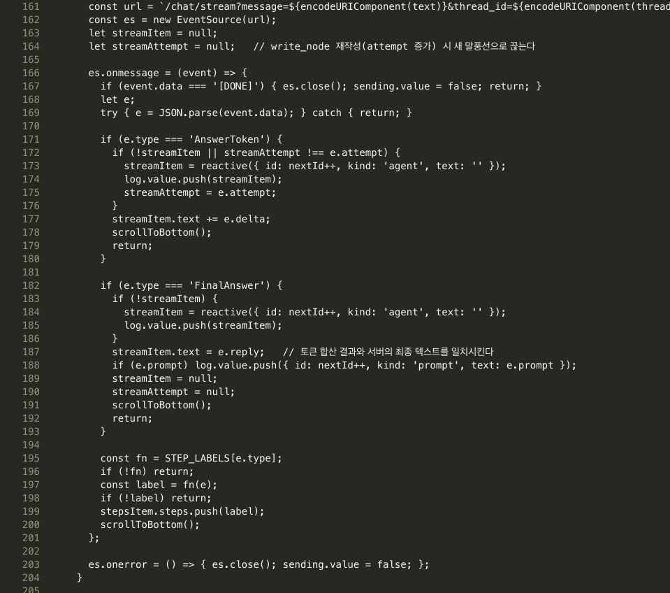

### 현재 동작

- EventSource로 GET SSE 연결을 생성한다.
- JSON parsing 실패 시 아무 메시지 없이 반환한다.
- Writing attempt가 달라질 때마다 새 Agent 말풍선을 만든다.
- FinalAnswer의 Prompt를 별도 UI에 추가한다.
- `onerror`에서는 연결을 닫고 버튼 상태만 복구한다.

### 왜 개선 검토가 필요한가

- 잘못된 SSE 이벤트가 와도 원인을 확인하기 어렵다.
- Validator가 반려한 잘못된 초안이 최종 답변과 함께 남는다.
- 사용자는 어떤 답변이 최종본인지 혼동할 수 있다.
- 내부 Prompt와 수집된 사실이 브라우저 사용자에게 노출된다.
- 네트워크 오류, backend 오류, parsing 오류가 모두 같은 무반응으로 보인다.
- 사용자가 요청을 중간에 취소할 수 없다.
- 알 수 없는 event type은 별도 기록 없이 무시된다.

---

## 6.8 Proxy backend 주소가 하드코딩돼 있음

## 6.9 요청마다 새로운 HTTP Client를 생성함

## 6.10 Upstream 오류 처리가 없음

코드 위치: [`web_demo_server.py` 22~60행](../web_demo_server.py#L22-L60)

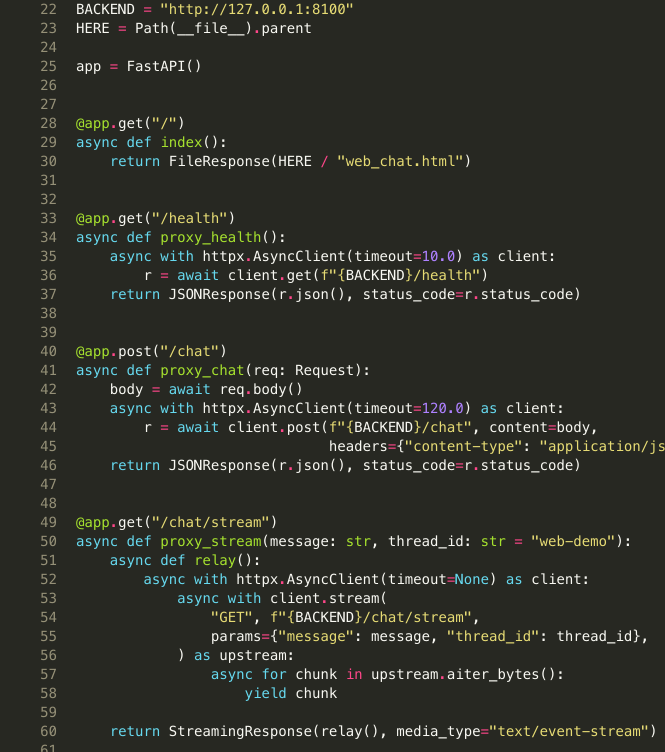

### 현재 동작

- backend 주소가 `http://127.0.0.1:8100`으로 고정돼 있다.
- health, chat, streaming 요청마다 새 `httpx.AsyncClient`를 생성한다.
- streaming 응답 bytes를 그대로 relay한다.
- 서버는 `0.0.0.0:8600`으로 실행된다.

### 왜 개선 검토가 필요한가

- 배포 환경에서 backend 주소가 달라지면 코드를 수정해야 한다.
- 요청마다 연결 객체를 새로 만들어 connection pooling 효과가 줄어든다.
- backend 연결 실패나 timeout이 사용자 친화적인 응답으로 변환되지 않는다.
- upstream streaming이 오류 상태여도 상태 코드와 본문을 SSE처럼 전달할 수 있다.
- proxy가 외부 인터페이스에 열리지만 인증과 접근 제한이 없다.
- Client 연결 종료가 upstream 요청 취소로 이어지는지 명확하지 않다.

---

# 7. 테스트, 평가, 의존성, 문서

## 7.1 회귀 테스트가 실행 가능한 코드가 아니라 질문 목록뿐임

코드 위치: [`doc/regression_test_queries.md` 1~14행](./regression_test_queries.md#L1-L14)

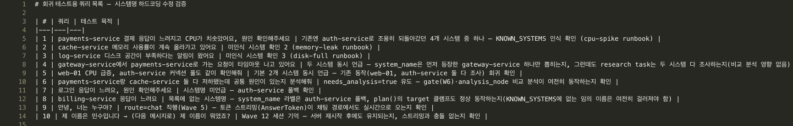

### 현재 상태

10개의 대표 질문과 테스트 목적은 문서로 작성돼 있다. 하지만 이를 자동으로 실행하고 결과를 판정하는 `tests/` 또는 `eval/` 코드는 없다.

### 왜 개선 검토가 필요한가

- 변경 전후 결과를 같은 조건으로 반복 측정하기 어렵다.
- 사람이 답변을 보고 판단해야 한다.
- Runbook 정확도, 수치 정확성, latency, retry 횟수가 자동 집계되지 않는다.
- LLM 변경으로 기존 기능이 깨져도 즉시 발견하기 어렵다.
- 교안의 Before/After 실측과 LLM-as-a-Judge 평가를 재현할 기반이 없다.

---

## 7.2 의존성 버전이 하한만 지정돼 있음

코드 위치: [`requirements.txt` 1~11행](../requirements.txt#L1-L11)

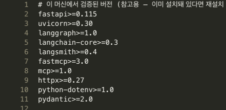

### 현재 상태

대부분의 패키지가 `>=` 최소 버전만 지정돼 있다.

### 왜 개선 검토가 필요한가

- 미래의 major 또는 breaking release도 설치될 수 있다.
- 설치 시점에 따라 서로 다른 버전 조합이 만들어진다.
- MCP SDK처럼 버전별 필드명이 달라지는 문제가 이미 코드에 반영돼 있다.
- 개발자 PC에서는 동작하지만 평가 환경에서는 동작하지 않을 가능성이 있다.
- 동일한 실험의 재현성이 낮아진다.

---

## 7.3 README가 존재하지 않는 `.env.example`을 안내함

코드 위치: [`doc/README.md` 31~45행](./README.md#L31-L45)

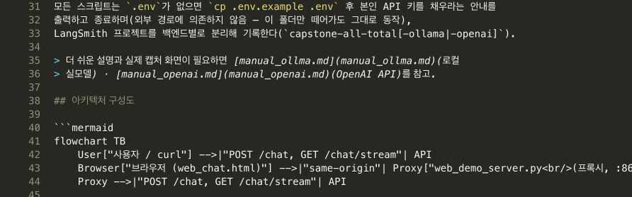

### 현재 상태

README와 실행 스크립트 설명은 `.env.example`을 복사하라고 안내한다. 현재 저장소에는 `.env`는 로컬에 존재하지만 `.env.example` 파일은 없다.

### 왜 개선 검토가 필요한가

- 새로 clone한 사용자는 필요한 환경변수 목록을 알기 어렵다.
- 실행 스크립트 안내와 실제 저장소 내용이 일치하지 않는다.
- 사용자가 실제 `.env`를 복사하거나 공유할 위험이 있다.
- 프로젝트의 최초 실행 재현성이 떨어진다.

---

# 8. 현재 해결된 항목

다음 항목은 코드 검토 중 위험으로 확인됐지만 앞선 작업에서 이미 처리했다.

## `.env`, `session.db`, `.venv`의 Git 포함 위험

프로젝트 루트에 `.gitignore`를 추가해 다음 항목을 Git 추적에서 제외했다.

- `.env`, `.env.*`
- `.venv/`
- `session.db`, SQLite 파일
- `__pycache__/`
- 로그, 캐시, 임시 파일
- `.DS_Store`, IDE 설정

따라서 이 항목은 현재 개선 필요 목록이 아니라 완료된 항목으로 분류한다.

---

# 9. 전체 항목 요약

| 번호 | 파일/영역 | 확인된 개선 필요 지점 | 주요 위험 |
|---:|---|---|---|
| 1 | `graph.py` | 미탐지 시스템을 `auth-service`로 변경 | 잘못된 대상 진단 |
| 2 | `graph.py` | 시스템 목록을 import 시 한 번만 로드 | 실행 중 데이터 불일치 |
| 3 | `graph.py` | Research마다 0.35초 지연 | 응답 지연과 측정 왜곡 |
| 4 | `graph.py` | gather task 오류 격리 없음 | 하나의 실패가 전체 중단 |
| 5 | `graph.py` | 영문 키워드 장애 분류 | 표현 변화와 복합 증상에 취약 |
| 6 | `graph.py` | 미분류 장애를 `db-down` 처리 | 근거 없는 장애 확정 |
| 7 | `graph.py` | Runbook 존재만으로 충분성 판단 | 불완전한 조사 통과 |
| 8 | `graph.py` | 길이와 `1)`만 검증 | 사실 오류 통과 |
| 9 | `graph.py` | 세 번째 실패 강제 합격 | 품질 미달 답변 노출 |
| 10 | `graph.py` | 모든 노드가 한 파일에 집중 | 유지보수성과 테스트성 저하 |
| 11 | LLM | 시스템 처리 로직 중복 | provider 간 동작 불일치 |
| 12 | LLM | Plan 정규화 로직 중복 | 비즈니스 규칙 중복 |
| 13 | LLM | 동기 HTTP 요청 | 이벤트 루프 블로킹 |
| 14 | LLM | OpenAI 의사 스트리밍 | 첫 토큰 지연 |
| 15 | Fake LLM | 첫 답변 의도적 실패 | 평가 지표 왜곡 |
| 16 | LLM | 단일 가상 비용 단가 | 실제 비용 오해 가능 |
| 17 | Session | 전체 history 무제한 조회 | 토큰과 Context 증가 |
| 18 | Session | 동기 SQLite | 요청 처리 블로킹 |
| 19 | Session | 단일 connection 공유 | 동시성과 transaction 위험 |
| 20 | Session | 보존·삭제·인덱스 정책 없음 | 성능과 개인정보 위험 |
| 21 | MCP Client | 첫 Tool 호출 강제 실패 | retry 지표 왜곡 |
| 22 | MCP Client | 전역 Lock | 실제 병렬성 제한 |
| 23 | MCP Client | 첫 번째 text 응답 가정 | 응답 형식 변화에 취약 |
| 24 | MCP Client | 부분 startup 정리 불명확 | subprocess 자원 누수 가능 |
| 25 | MCP Server | 무작위 monitoring jitter | 평가 재현성 저하 |
| 26 | MCP Server | 호출마다 JSON 파일 읽기 | 반복 파일 I/O |
| 27 | MCP Server | 정확한 파일명 Runbook 조회 | 의미 기반 검색 불가 |
| 28 | MCP Server | Not Found를 정상 문자열 반환 | 오류와 정상 응답 혼동 |
| 29 | Retry | TimeoutError만 분류 | 다른 transient 오류 누락 |
| 30 | Server | 잘못된 backend가 fake로 전환 | 설정 오류 은폐 |
| 31 | Server | 잘못된 version이 v1로 전환 | 설정 오류 은폐 |
| 32 | Server | startup 중간 실패 정리 취약 | MCP 자원 누수 가능 |
| 33 | Server | 성공 후에만 세션 저장 | 실패 요청 추적 불가 |
| 34 | Server | SSE GET에 사용자 메시지 포함 | URL과 로그 노출 |
| 35 | Server | v1 SSE 세션 저장 누락 | 버전별 동작 불일치 |
| 36 | Server | 연결 종료와 SSE 오류 처리 없음 | 불필요한 작업과 무응답 |
| 37 | Server | 인증·제한·공통 오류 없음 | 비용 남용과 운영 위험 |
| 38 | Frontend | Vue CDN 버전 미고정 | 실행 재현성 저하 |
| 39 | Frontend | fake도 실모델로 표시 | 잘못된 상태 안내 |
| 40 | Frontend | 새로고침마다 새 thread | 대화 연속성 상실 |
| 41 | Frontend | parsing 오류 무시 | 장애 원인 확인 어려움 |
| 42 | Frontend | 반려된 초안 유지 | 사용자 혼동 |
| 43 | Frontend | 최종 Prompt 노출 | 내부 정보 노출 |
| 44 | Frontend | onerror 사용자 안내 없음 | 실패가 무반응으로 보임 |
| 45 | Proxy | backend 주소 하드코딩 | 배포 환경 변경 어려움 |
| 46 | Proxy | 요청마다 새 HTTP Client | 연결 재사용 불가 |
| 47 | Proxy | upstream 오류 처리 없음 | 잘못된 streaming 응답 |
| 48 | Test/Eval | 수동 질문 목록만 존재 | 자동 회귀와 수치 비교 불가 |
| 49 | Dependency | 최소 버전만 지정 | 설치 결과 재현성 저하 |
| 50 | Documentation | `.env.example` 안내와 파일 불일치 | 최초 실행 실패 가능 |

---

이 문서는 현재 발견된 문제를 빠짐없이 모아둔 검토 기록이다. 실제 개선 범위와 구현 방식은 위 항목 중 하나를 선택한 뒤 별도로 논의한다.
